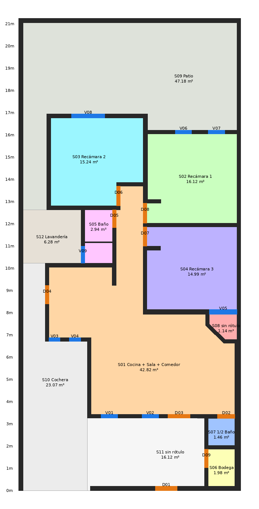

# Fase 2 — Modelo de hechos, IFC y House MCP

Fuente: [`sources/casa-jonhy-levantamiento.pdf`](../../sources/casa-jonhy-levantamiento.pdf) (el DXF todavía no está en el repo).
Generado con `python -m house_twin.cli build`. Las tablas salen de
[`data/facts/existing.facts.json`](../../data/facts/existing.facts.json).

La imagen se dibuja **solo desde el JSON de hechos**, no desde el PDF. Si coincide con el plano, los hechos están completos.

## Qué cambió respecto a la fase 1

| Aspecto | Fase 1 | Fase 2 |
|---|---|---|
| Espacios | raster de 2 cm con flood-fill | polígonos exactos (shapely) |
| Áreas | subestimadas ~0.2–1.6 m² por el grosor del raster | exactas entre caras de muro |
| Muros | líneas sueltas | **43 tramos rectos** con eje, largo, espesor, colindancia, exposición |
| Vanos | 10 por jambas, varios mal emparejados | **9 puertas + 9 ventanas** con muro anfitrión y espacios que conectan |
| Relaciones | ninguna | adyacencias (puerta / ventana / solo muro) y recorridos por puertas |

## Espacios

| Id | Espacio | Área libre (m²) | Perímetro (m) | NPT | Fuente del nombre |
|---|---|---|---|---|---|
| S01 | Cocina + Sala + Comedor | 42.82 | 38.47 | 0.15 | rótulos del plano |
| S02 | Recámara 1 (con closet) | 16.12 | 17.35 | 0.15 | rótulo |
| S03 | Recámara 2 (con closet) | 15.24 | 16.25 | 0.15 | rótulo |
| S04 | Recámara 3 (con closet) | 14.99 | 16.80 | 0.15 | rótulo |
| S05 | Baño (incluye la regadera tras el murete de 5 cm) | 2.94 | 7.30 | 0.15 | **dueño** |
| S06 | Bodega | 1.98 | 5.71 | 0.00 | rótulo |
| S07 | 1/2 Baño | 1.46 | 4.84 | 0.00 | rótulo |
| S08 | sin nombre (recinto triangular con un árbol dibujado) | 1.14 | 4.31 | — | — |
| S09 | Patio (exterior, detrás de las recámaras) | 47.18 | 37.59 | — | **dueño** |
| S10 | Cochera (exterior, a la izquierda de la cocina y la sala) | 23.07 | 26.27 | 0.00 | **dueño** |
| S11 | sin nombre (exterior frente a la sala) | 16.12 | 17.05 | — | — (U09) |
| S12 | Lavandería (exterior, sin techo ni cerramiento) | 6.28 | 10.03 | — | **dueño** |

- Interior con nombre: 95.55 m². Con S08: 96.69 m².
- El área del baño descuenta el murete interior (W29).
- Los exteriores no tienen muros entre sí. Sus límites son los que indicó el dueño:
  - Patio: detrás de la línea del muro sur de la Recámara 2 (y = 12.62 m).
  - Lavandería: entre esa línea, el muro norte de la cocina (y = 10.22 m) y el muro oeste del baño.
  - Cochera: a la izquierda de la línea del muro oeste de la sala (x = 3.115 m).
- El modelo los marca como conectados "abiertos": `walk_path` los cruza sin puerta.

## Aportes del dueño

Viven en [`sources/owner-annotations.json`](../../sources/owner-annotations.json), separados del plano. Cada espacio afectado lleva `name_source: "dueño (fecha)"`.

- **Baño:** las dos piezas que separa el murete de 5 cm son un solo baño.
- **Lavandería:** fuera de la casa, detrás del baño. La ventana del baño (V09) da hacia ella. No está techada ni cerrada.
- **Patio:** la parte exterior detrás de los cuartos.
- **Cochera:** la parte exterior fuera de la cocina, del lado izquierdo.

Sin el archivo de anotaciones, el plano solo da 9 recintos interiores y un único exterior. Un test lo verifica.

## Vanos

| Id | Tipo | Ancho (m) | Antepecho / altura (m) | Muro | Conecta |
|---|---|---|---|---|---|
| D01 | puerta | 0.979 | — / ? | W03 | Frente (S11) ↔ calle (puerta peatonal en barda) |
| D02 | puerta | 0.780 | — / ? | W06 | Zona social ↔ 1/2 Baño |
| D03 | puerta | 1.002 | — / ? | W07 | Zona social ↔ Frente (S11) (acceso principal) |
| D04 | puerta | 0.832 | — / ? | W13 | Cocina ↔ Cochera (pasillo lateral) |
| D05 | puerta | 0.799 | — / ? | W19 | Zona social ↔ Baño |
| D06 | puerta | 0.878 | — / ? | W26 | Zona social ↔ Recámara 2 |
| D07 | puerta | 0.858 | — / ? | W08 | Zona social ↔ Recámara 3 |
| D08 | puerta | 0.894 | — / ? | W08 | Zona social ↔ Recámara 1 |
| D09 | puerta | 0.835 | — / ? | W24 | Bodega ↔ Frente (S11) |
| V01 | ventana | 0.744 | 0.865 / 1.27 | W07 | Sala ↔ Frente (S11) |
| V02 | ventana | 0.750 | 0.85 / 1.26 | W07 | Sala ↔ Frente (S11) |
| V03 | ventana | 0.498 | 0.86 / 1.27 | W13 | Cocina ↔ Cochera |
| V04 | ventana | 0.511 | 0.87 / 1.27 | W23 | Cocina ↔ Cochera |
| V05 | ventana | 1.238 | 0.86 / 1.26 | W04 | Recámara 3 ↔ S08 (recinto triangular) |
| V06 | ventana | 0.734 | 0.85 / 1.22 | W10 | Recámara 1 ↔ Patio trasero |
| V07 | ventana | 0.750 | 0.855 / 1.23 | W10 | Recámara 1 ↔ Patio trasero |
| V08 | ventana | 1.500 | 0.86 / 1.22 | W09 | Recámara 2 ↔ Patio trasero |
| V09 | ventana | 0.780 | 1.28 / 0.60 | W15 | Baño ↔ Lavandería (ventana alta) |

## Muros

- 43 tramos rectos, sin solapes entre sí, que cubren toda la masa de muro del plano (23.49 m²).
- Los encuentros (esquinas, T) quedan asignados al tramo más largo.
- 9 tramos están **sobre el lindero** (`on_property_line`) y 23 dan al exterior (`faces_exterior`).
- Espesores medidos: 0.05 (murete de la regadera), 0.17–0.19 (muros) y 0.20 (barda).
  - Hay un tramo de 0.265 m: la barda este junto al ½ baño y la bodega.
- Desconocido para todos: altura, si es de carga, material.

## IFC (`models/existing.ifc`)

- IFC4 sin errores de esquema (`ifcopenshell.validate`). La geometría 3D se genera completa, cortes de vano incluidos.
- Contenido:
  - `IfcSite → IfcBuilding → IfcBuildingStorey`;
  - 43 `IfcWall`;
  - 18 `IfcOpeningElement` que vacían su muro anfitrión, rellenos con 9 `IfcDoor` y 9 `IfcWindow`;
  - 12 `IfcSpace`.
- **Supuestos** (solo en el IFC, marcados en `HDT_Provenance`):
  - entrepiso 2.40 m;
  - puertas 2.10 m.
- Las ventanas usan el antepecho y la altura del plano.
- Sin probar todavía en Blender/Bonsai desde aquí. Validado solo con IfcOpenShell.

## House MCP

Servidor `house` (`python -m house_twin.mcp_server`, ya registrado en `.mcp.json`):

| Herramienta | Qué responde |
|---|---|
| `house_summary` | terreno, área interior, conteos, procedencia |
| `list_rooms` / `get_room` | espacios; detalle con polígono, vanos y vecinos |
| `get_adjacent_rooms` | vecinos y si se conectan por puerta, ventana o solo muro |
| `calculate_area` | área libre y perímetro |
| `get_wall` | eje, largo, espesor, colindancia, qué separa, qué vanos tiene |
| `walk_path` | recorrido por puertas entre dos espacios |
| `list_unknowns` | lo que el plano no dice y qué análisis bloquea |

Los nombres se buscan sin importar acentos ni mayúsculas: "recamara 1" funciona, y "sala" encuentra la zona social. Si la búsqueda es ambigua, responde con las opciones.

## Incógnitas que bloquean la segunda planta

Están en `unknowns` del JSON (U01–U10).

- **Bloquean la segunda planta:** entrepiso, losa, estructura y muros de carga, techo de la cochera.
- **Además:** altura de puertas, materiales, la discrepancia de las cotas generales (10.023 contra 10.00), la lectura de `a=`/`h=`, qué es el frente S11 y si S08 es jardinera a cielo abierto.

## Pendiente para la fase 3

1. Subir el DXF a `sources/` y correr `inspect-dxf` y `compare`.
   - El adaptador ya está probado con un DXF sintético: en cm y en m, con y sin `$INSUNITS`, y con puertas como bloque.
2. Si el DXF trae capas que el PDF no imprimió (estructura), mapearlas en `LAYER_ROLES`.
