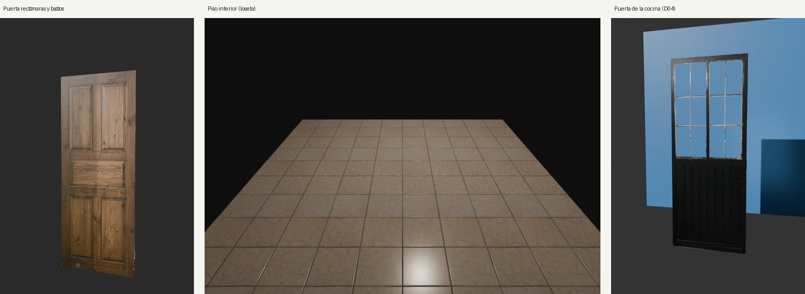
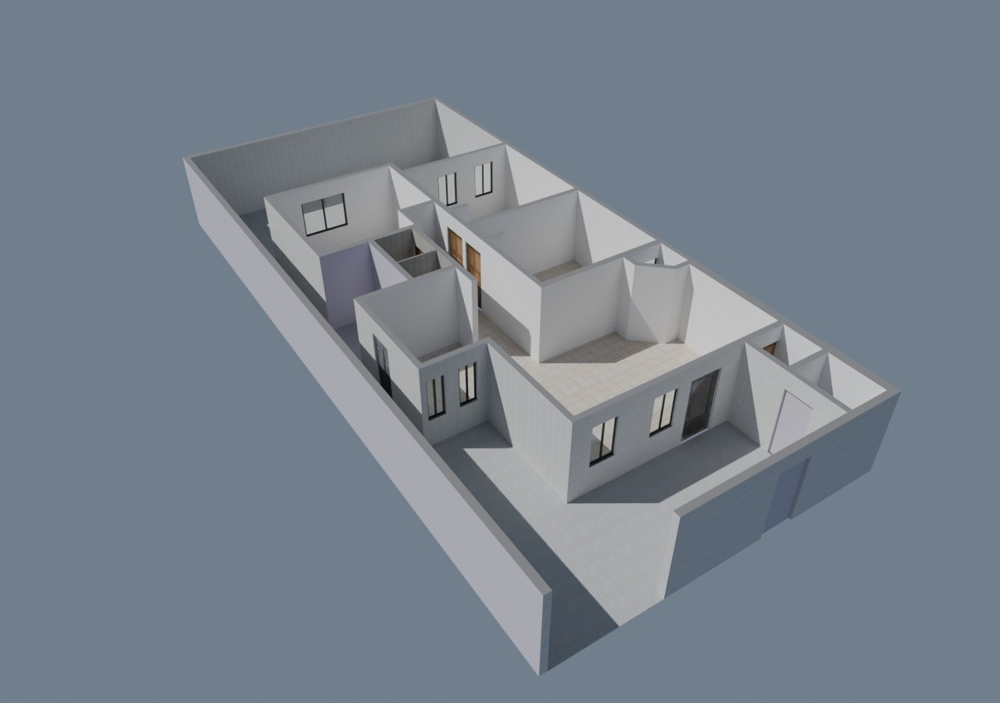
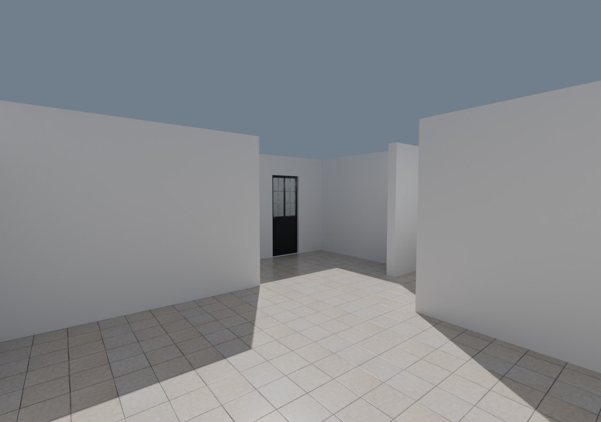
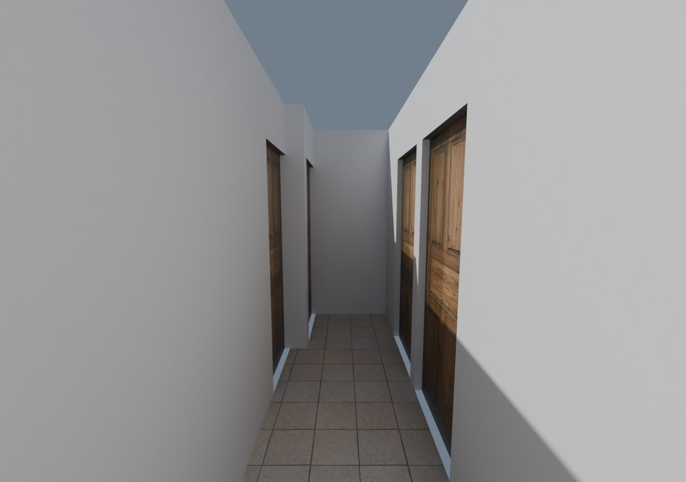
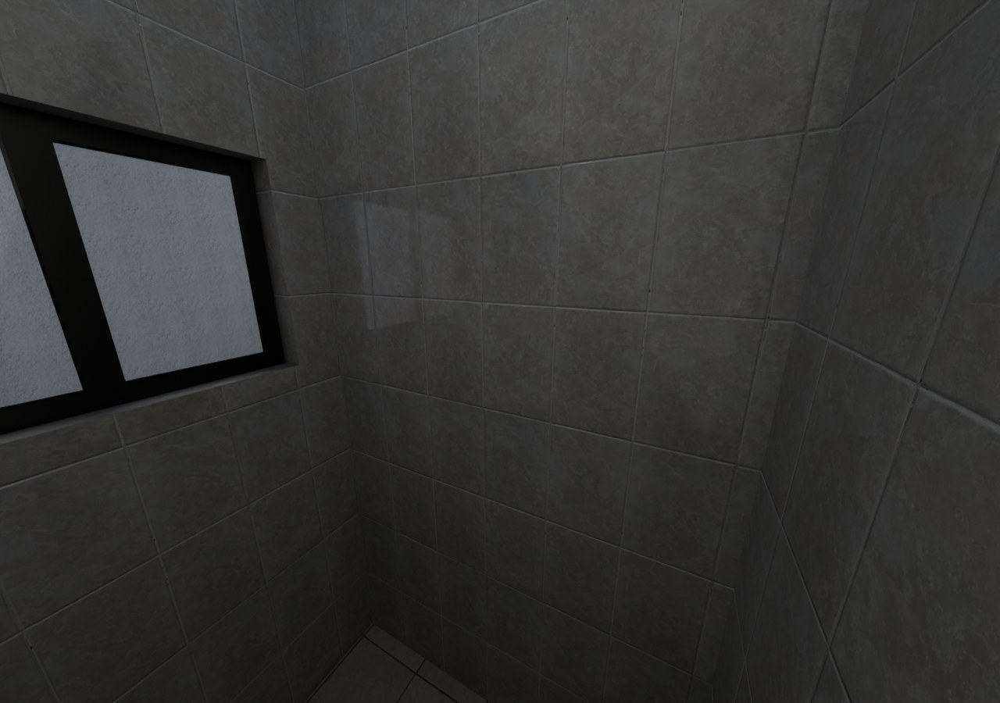

# Fase 4: acabados y texturas a partir de fotos

Fuente: 14 fotos del dueño, del 2026-10-07 (23:18–23:33) y del 2026-10-08 (07:45–07:56). Todas son de noche, con luz artificial cálida, sin flash, tomadas con un Samsung Galaxy S25 Ultra en gran angular (23 mm equivalente). Las originales están en `sources/fotos/`, fuera de git. Cada material se describe en `sources/texturas/<nombre>.json` y se genera en `assets/textures/<nombre>/` con:

```bash
python -m house_twin.cli texture sources/texturas/<nombre>.json
```



## Materiales

| Material | Tipo | Aplica a | Fuente del dato |
|---|---|---|---|
| `puerta-recamaras` | Mapas: color, rugosidad, relieve | Puertas D02, D05, D06, D07 y D08 | Foto; el dueño dice que las 5 son iguales |
| `piso-interior` | Mapas repetibles (2 × 3 losetas) | Piso de S01–S05, S07 y el tragaluz S08 | Foto; el dueño dice que es el piso de todo el interior |
| `puerta-cocina` | Mapas + opacidad para los vidrios | Puerta D04 | Foto y dueño |
| `azulejo-bano` | Mapas repetibles (3 × 2 azulejos) | Muros del baño S05 | Foto; el dueño dice que es el azulejo del baño con regadera |
| `piso-exterior` | Mapas repetibles (≈ 1 × 1 m, sin juntas) | Piso de S06 y S09–S13 | Foto; el dueño dice que todos los exteriores son de concreto gris |
| `piso-regadera` | Mapas repetibles (2 × 2 losetas de mosaico) | Piso de la regadera (S05) | Foto; el dueño dice que el antiderrapante está solo en la regadera |
| `puerta-pasillo` | Mapas + opacidad de herrería (casi todo hueco) | 2 puertas nuevas del pasillo de servicio: hacia la cochera (S10–S12) y hacia el patio (S12–S09) | Foto y dueño (las dos son iguales); **no están en el plano** |
| `closet-madera` | Mapas repetibles de la veta impresa (hojas lisas de melamina) | Puertas de closet de 2 recámaras | Foto; el dueño dice que el closet de la recámara más grande (R1) no tiene puertas |
| `puerta-entrada` | Mapas + opacidad para el vidrio | Puerta D03 (entrada a la sala) | Foto y dueño |
| `aluminio-negro` | Constante (color medido) | Marcos y hojas de V01–V10 | Foto; el dueño dice que todas las ventanas son de aluminio negro |
| `vidrio-claro` | Constante (supuesto) | Vidrios de las ventanas y de D04 | Supuesto |
| `vidrio-polarizado` | Constante (supuesto) | Vidrio de D03 | Dueño: «ventanal polarizado»; tono y transmisión supuestos |
| `aplanado-exterior` | Mapas repetibles (≈ 0.5 × 0.5 m) con relieve alto | Muros exteriores del pasillo de servicio, el patio y la cochera | Foto y dueño; el pórtico es más rugoso (pastas de estuco, textura pendiente) |
| `estuco-fachada` | **Sintética** (procedural, repetible) | Fachada a la calle y pórtico | Dueño: punto medio entre dos referencias de catálogo («Lace Trowel» y «Pebbled Dash»); sin foto de la casa |
| `muro-interior` | Constante | Muros interiores | Dueño: yeso blanco con pintura blanca |

**Exteriores y bodega** (dato del dueño): pórtico, bodega, cochera, pasillo de servicio, lavandería y patio no tienen loseta. Su piso es un firme de concreto gris (foto 9); el dueño confirma que es el mismo en todos. El tragaluz tiene la loseta del interior.

## Cómo se obtiene cada textura

1. **Perspectiva:** se marcan las 4 esquinas de la superficie en la foto y se lleva a un rectángulo del tamaño real.
2. **Color:** se corrige en espacio lineal con una superficie que se sabe blanca y está en el mismo plano. Si la foto no tiene blanco, se usa el balance de otra foto con la misma luz y la luminosidad queda declarada como supuesto.
3. **Luz desigual:** se quita dividiendo por una superficie cuadrática ajustada a la luminancia, sin contar las juntas.
4. **Herrajes:** perillas y cerraduras se tapan con un trozo de la misma pieza. Irán como objetos 3D aparte.
5. **Relieve:** sale de la geometría medida en la foto (tableros, juntas, acanalados), más la veta del detalle fino.
6. **Repetición:** los pisos con juntas se recortan por el eje de las juntas. Los que no tienen juntas (concreto) se hacen repetibles mezclando el recorte con una copia desplazada (`make_seamless`).

Los defectos reales (salpicaduras de pintura, marcas) se conservan.

## Hallazgos por foto

### 1. Puerta de recámaras y baños (23:18:45)

- **Puerta:** de 5 tableros realzados (2 arriba, 1 central horizontal y 2 abajo), de pino con nudos entintado nogal y barniz satinado.
- **Proporción:** la hoja mide unas 2.52 veces su ancho de alto; con una altura de ~2.04 m saldría de ~0.80 m de ancho.
- **Herrajes:** perilla de latón envejecido con seguro de botón y 3 bisagras de libro. La puerta abre hacia quien tomó la foto.
- **Marco:** de pino, sin chambrana, con escurrimientos de pintura blanca.
- **Contexto:** apagador de placa negra en el nicho, a la altura de la perilla.
- **Conflicto con el plano:** los vanos de los baños miden 0.80 m (D05) y 0.78 m (D02). Ahí no cabe una hoja de 0.80 m más su marco. Hay que medir la hoja.

### 2. Piso interior (23:19:01)

- **Loseta:** cerámica esmaltada beige claro con veteado tipo mármol, puesta a junta corrida.
- **Esmalte:** brillante, con micro relieve; el reflejo de la lámpara sale moteado.
- **Junta:** gris oscuro, mide el 1.7–1.8 % de la loseta (~5 mm).
- **Geometría:** la cuadrícula es regular; error de 3 px al comprobar con un cruce intermedio.
- **Tamaño:** se estimó ~30 × 30 cm por la escala de la puerta. Falta medirlo.
- **Color:** en la foto no hay blanco de referencia, así que la luminosidad del beige es supuesta.

### 3. Ventana (23:19:20)

- **Ventana:** corrediza de 2 hojas, con perfil de aluminio negro casi puro (`#10110d`).
- **Acabado:** satinado, sin brillo metálico; se trata como pintura o anodizado.
- **Pestillo:** negro, en el larguero de la hoja corrediza.
- **Empotrado:** en el muro, con mocheta y repisón de yeso.
- **Persiana:** encima tiene la caja de una persiana enrollable de aluminio plata. No sabemos si todas las ventanas la tienen.
- **Estado:** salpicaduras de pintura blanca (9–14 % del área de los perfiles laterales) y marcas naranjas en el cabezal. Son de esta ventana y no se generalizan.
- **Vidrio:** la hoja fija se ve con un reflejo verdoso más claro que la corrediza. Puede ser película o vidrio entintado.
- **Medidas:** la foto no muestra la ventana completa (falta el borde izquierdo), así que no se puede medir el ancho.

### 4. Muro interior (23:19:39)

- **Superficie:** yeso liso con pintura blanca mate. El detalle fino de la foto (desviación de 0.98 niveles) es ruido del sensor, no relieve, así que el material va sin mapas.
- **Color:** no se puede medir, porque este mismo blanco es la referencia de las demás fotos. Se declara 235 sRGB.
- **Estado:** una perforación de clavo y rozaduras cerca del piso.
- **Contexto:** pantalla LED montada en el muro.
- Junto a la puerta de la foto 1, el yeso se veía con textura de llana. Puede ser una zona retocada.

### 5. Puerta de la cocina, D04 (23:20:28)

- **Hoja:** marco y hoja de perfil negro con esmalte brillante a brocha.
- **Arriba:** 2 vidrios con retícula blanca (1 barra vertical y 2 horizontales cada uno) y 4 adornos de fundición soldados.
- **Abajo:** tablero de lámina acanalada, con 7 juntas de duela de doble ranura cada ~8.5 cm.
- **Herrajes:** 2 bisagras de munición del lado izquierdo, una cerradura de sobreponer, un pasador con llave y una pieza cilíndrica arriba a la derecha.
- **Material:** las soldaduras, los adornos de fundición y la cerradura de sobreponer son típicos de **herrería de acero**. El dueño dice que es aluminio pintado; queda por confirmar (un imán lo resuelve).
- **Vidrio:** transparente, con suciedad.
- **Contexto:** a la derecha hay azulejo blanco brillante con una cenefa de frutas y platos de talavera. Es un acabado de la cocina que todavía no tiene textura.
- **Medidas:** la textura usa el vano D04 (0.83 m del plano y 2.10 m de U04), suponiendo que el marco negro ocupa todo el vano.

### 6. Puerta de entrada, D03 (23:22:08)

- **Puerta:** metálica, de una hoja. Arriba tiene un vidrio polarizado grande con moldura a inglete; abajo, un tablero hundido.
- **Acabado:** pintura negra mate muy envejecida sobre una superficie rugosa, con moteado claro. Debajo se asoman restos de **pintura verde agua**, el color anterior.
- **Óxido:** en todo el contorno del marco, en el travesaño inferior y en manchas del tablero.
- **Herrajes:** 3 bisagras de munición soldadas a la izquierda. A la derecha, de arriba abajo: aldaba de palanca, cerrojo de seguridad y manija de palanca con seguro (las dos de latón envejecido), y un pasador cromado con llave.
- **Bisagras:** quedan a unos 14 cm del borde izquierdo del conjunto. Probablemente hay un marco fijo ancho a la izquierda y la hoja es más angosta que el vano de 1.00 m.
- **Umbral:** de aluminio, atornillado al piso.
- **Cordones amarillos:** dos, atados arriba. Son provisionales y no entran en la textura.
- **Textura:**
  - Usa el vano D03 (1.00 × 2.10 m) y su relieve tiene más grano, para reproducir la superficie rugosa.
  - Los herrajes se taparon con el mismo larguero; ese parche repite una mancha verde agua de más arriba.
  - El cerradero del pasador queda, porque va en el marco.

### 7. Azulejo del baño con regadera (23:33:31 y 07:53:10)

Son dos fotos del mismo muro. La de lejos (gran angular de 13 mm) da 3 × 2 azulejos para la textura. La de cerca (23 mm) da la proporción y el estado.

- **Azulejo:** cerámico esmaltado, rectangular vertical, puesto a junta corrida. Es gris claro con vetas y nubes beige y blancas tipo mármol o piedra.
- **Esmalte:** muy brillante; la lámpara se refleja como un punto nítido.
- **Proporción:** alto/ancho ≈ 1.47 en la foto de cerca, casi de frente. Es compatible con **20 × 30 cm**, pero falta medirlo.
- **Junta:** boquilla blanca de ≈ 3 mm, hundida, con suciedad oscura. Tiene un **tramo vertical abierto** (sin boquilla) en la parte baja.
- **Color:** en la foto de cerca, el centro de la junta sale *más oscuro* que el azulejo (≈ 113 contra 150), porque está hundida y sucia; lo que se ve claro a sus lados es el canto brillante. Esa foto no sirve como blanco. En la de lejos, junta y canto se mezclan en un tono casi neutro: se usa como referencia aproximada (albedo 225).
- **Textura:** el reflejo de la lámpara en un azulejo se tapó con el mismo azulejo.
- **Contexto:** a la derecha está la puerta de madera de los baños (la misma de `puerta-recamaras`) y abajo a la izquierda, el inodoro.

### 8. Piso antiderrapante de la regadera (07:56:01)

- **Loseta:** cerámica antiderrapante con **diseño de mosaico**. Cada pieza tiene **6 × 6 cuadritos** de superficie granulada, color piedra gris-beige, separados por canales blancos esmaltados.
- **Junta entre losetas:** de cemento gris, ancha (≈ 5–7 mm), sucia y con trazo algo irregular.
- **Tamaño:** la loseta mide ≈ 1.55 veces la tapa de la coladera. Si la coladera es de ~11 cm (medida comercial común), la loseta sale de **17–20 cm**. Se usó 20 × 20 cm.
- **Coladera:** redonda, de acero inoxidable, con 6 ranuras y 2 tornillos, en un aro de cemento. Tiene pelo acumulado y **una grieta en la junta** que sale hacia la derecha.
- **Desgaste:** el estampado se ve gastado en manchas claras sobre varias losetas. Hay manchas amarillas de jabón en la esquina con el muro.
- **Muro de la regadera:** las piezas que se ven arriba de este piso parecen grises, mate y más grandes que el azulejo del resto del baño. Falta confirmarlo.
- **Textura:**
  - Usa 2 × 2 losetas, con la coladera y la sombra fuera del recorte.
  - El relieve tiene dos niveles: junta hundida entre losetas y canales entre cuadritos.
  - Rugosidad: cuadritos mate, canales con brillo y junta mate.
  - El blanco de referencia es el de los canales.

### 9. Piso de concreto de los exteriores (07:47:52)

- **Firme:** de concreto gris con **acabado escobillado en ondas**. Las estrías finas onduladas lo hacen antiderrapante; tiene poros, granos de arena expuestos y algunas piedritas.
- **Color:** con luz de día el gris sale neutro (`#babbbb` tal como lo registró la cámara). La luminosidad media es supuesta (albedo ≈ 0.40), porque la exposición automática no la fija.
- **Manchas gris azuladas** abajo a la derecha. Conservan la textura de ondas y, según el dueño, **no son humedad**. Su origen queda sin identificar (sellador, pintura o cemento de otra mezcla). Quedan fuera del recorte.
- **Junta o grieta diagonal** en el borde derecho, con una superficie más lisa del otro lado (otro colado o una banqueta).
- **Escala:** no hay nada de tamaño conocido en la foto. Se supuso una foto tomada de pie, a ≈ 1.4 m, así que el recorte mide ≈ 1 × 1 m.
- **Textura:** es repetible sin costuras gracias a `make_seamless`. En áreas grandes se nota algo la repetición cada metro; con más fotos del exterior se podría variar.

### 10. Puertas de herrería del pasillo de servicio (07:48:20)

- **Son dos y no están en el plano ni en el modelo:** la foto es la que da a la cochera; el dueño dice que la que da al patio es igual. En el modelo las adyacencias S10–S12 y S12–S09 aparecen abiertas (sin muro ni puerta). Los dos límites del pasillo miden 1.005 m, lo que cuadra con dos puertas iguales. Hay que agregarlas como dato del dueño, con su posición y medidas.
- **Puerta:** de herrería de una hoja. Tiene marco de perfil, 3 barrotes cuadrados torcidos, 3 barrotes lisos con 2 adornos de fundición en rombo cada uno, 4 travesaños, 10 arillos de solera (filas de 3, 4 y 3) y lámina lisa en el tercio inferior.
- **Acabado:** pintura negra a brocha (`#0d0e10` medido en la lámina), con polvo, desgaste y marcas de brocha.
- **Herrajes:** bisagras de perno con ménsula anclada al muro, del lado izquierdo; portacandado de lámina con candado, del lado derecho.
- **Provisionales:** cinta, trapo y amarres de alambre y cordón.
- **Contexto visible:** el concreto de la cochera con un registro cuadrado, el portón de herrería negro hacia la calle y la barda colindante blanca con remate de tabique rojo.
- **Textura:**
  - La opacidad sale de la geometría medida (rectángulos, arillos y adornos), ajustada a la silueta oscura de la foto.
  - Las piezas toman el color de la pintura, porque su borde en la foto es cielo.
  - Ancho: el hueco del plano (1.005 m). Alto: supuesto (2.00 m).
  - Límite: junto a los dos primeros arillos del centro queda una pequeña mancha del portón de la calle, que está detrás y también es negro.

### 11. Puertas de closet (07:45:49 y 07:46:12)

- **Closet:** empotrado de muro a muro y del piso al techo. Tiene **3 módulos**, cada uno con 2 hojas altas y 2 puertas de maletero arriba.
- **Hojas:** lisas, sin tableros ni molduras. Tienen **jaladeras de barra de acero inoxidable** verticales, en pares al centro de cada módulo, y más cortas en los maleteros.
- **Acabado:** **melamina** (confirmado por el dueño) color chocolate oscuro tipo wengué, con veta vertical impresa fina y satinada.
- **Estado:** huellas y manchas de grasa, un rayón en una hoja y la junta con el muro sin acabar (relleno de yeso, con pintura naranja asomando).
- **Color incierto:** con su blanco de referencia, la foto 1 da `#55484d` (cerca, con reflejo) y la foto 2 `#272426` (lejos, en sombra). Cada blanco recibe otra luz que el closet. Se conservó el tono café de la cámara con una luminosidad intermedia supuesta.
- **Otros acabados que aparecen en la foto 2:**
  - **Techo con textura de tirol** (rugoso). Es un acabado distinto al muro liso y todavía no tiene textura.
  - **Zoclo de loseta** en el muro.
- **Por la regla del dueño:** R1 (16.15 m², la más grande) tiene closet sin puertas, y R2 y R3 sí tienen.

### 12. Aplanado exterior de pasillo, patio y cochera (07:49:12)

- **Acabado:** aplanado de mortero lanzado (**zarpeo / tirol rústico**) con pintura blanca mate. Tiene crestas irregulares, cráteres y poros de 1 a 10 mm, y algunos filos marcados. Coincide con lo que dice el dueño: rugosidad alta, «casi como bordes».
- **Dónde va (corrección del dueño):** muros exteriores del pasillo de servicio, el patio y la cochera. El **pórtico es aún más rugoso, con pastas de estuco**: necesita su propia textura.
- **Estado:** hay polvo gris acumulado en las cavidades, manchas grises y una zona con la pintura desgastada.
- **Relieve:** tiene varias escalas, de detalle fino a crestas de ≈ 1 cm. El generador ahora acepta `grain_blur_px` para fijar la escala más grande que cuenta como relieve; aquí, 24 px. La amplitud de 3 mm es supuesta.
- **Escala:** supuesta. La foto se tomó a ≈ 0.5 m, así que el recorte mide ≈ 0.5 × 0.5 m.
- **Color:** con luz de día difusa sale neutro. La luminosidad del blanco exterior es supuesta (albedo ≈ 0.73).

### 13. Estuco de la fachada y el pórtico (sintético)

- **Por qué es sintético:** el dueño describe el acabado como más rugoso que los demás exteriores, con «pastas de estuco», y da como guía un **punto medio entre dos referencias de catálogo**: «Lace Trowel» (placas grandes aplanadas por la llana, con bordes marcados) y «Pebbled Dash» (grano fino de piedrita). No hay foto de cerca de este acabado.
- **Cómo se genera:** por código (`kind: procedural`), con ruido periódico, así que se repite sin costura. Lleva placas de ≈ 3 cm que cubren ≈ 45 % de la superficie, con 3 mm de relieve y bordes marcados, sobre grano fino de 0.25 mm. Es más oscuro entre placas por polvo y sombra fina, y la semilla es fija.
- **Es una aproximación, no una observación:** forma, tamaño y relieve son interpretación. Hay que reemplazarlo por una textura de foto cuando la haya.
- **Las referencias** son imágenes de catálogo: no se guardan en el repo.
- **Foto de las 07:49:34 (`20261008_074934.jpg`):** muestra una puerta de lámina negra acanalada junto a una ventana con herrería. Los muros de alrededor no tienen placas: uno es de grano rugoso y el otro casi liso con poros. El dueño confirma que es la puerta de la bodega (D09): ver la sección 14.

### 14. Puerta de la bodega D09 (07:49:34)

- **Qué es (dato del dueño):** la puerta de la bodega, fotografiada desde el pórtico.
- **Conjunto:** ocupa el vano de 0.835 × 2.10 m.
  - **Marco de perfil.**
  - **Fijo arriba:** lámina acanalada con 9 costillas a ≈ 8.1 cm, soldada a un ángulo con puntos arriba, abajo y a los lados. La mayoría de las soldaduras tiene óxido.
  - **Hoja:** dos tableros de duela de lámina (8 duelas de ≈ 8 cm, con bordón y ranura en cada unión) con moldura de 2 cm y una solera sobrepuesta a media altura.
- **Herrajes:** la chapa de cilindro va a la izquierda y la jaladera cromada de asa sobre la solera. Las bisagras van a la derecha. No van en la textura: irán como objetos 3D.
- **Cómo se genera: dibujada, no copiada.** La textura de D03 pegó la foto y con ella el reflejo del fotógrafo en el vidrio. Aquí el esmalte refleja el cielo como una mancha azulada, así que la foto rectificada solo se usa para medir:
  - **Geometría:** la posición de cada pieza, en fracciones de la cara.
  - **Colores:** pintura `#1d1f22` (la parte más oscura de las duelas, que coincide con el fijo en sombra), óxido `#493a37` y polvo `#3c3c3e`. El blanco de referencia es el muro derecho, con albedo supuesto de 222.
  - El generador `sheet_door` arma el relieve con esas medidas y oscurece lo hundido. Reparte el óxido de las soldaduras y el polvo de la parte baja con ruido, y el brillo lo da el render con la rugosidad (esmalte satinado, 0.4).
- **Lado de la foto (`viewed_from`):** la textura declara desde qué espacio se fotografió, y la escena orienta la UV para que de ese lado no salga espejada. Aquí la chapa queda a la izquierda vista desde el pórtico. D03 también lo declara: su foto es desde la sala.
- **Supuestos:** las profundidades del relieve, que la cara hacia la bodega es igual y que el conjunto llena el vano.

## Recorrido del interior (2026-10-08, fotos de conjunto)

Fotos de conjunto en `sources/fotos/` (fuera de git): `bano-general`, `bano-regadera`, `sala-comedor-1`, `comedor-hacia-cocina`, `comedor-hacia-sala`, `sala-hacia-comedor`, `cocina-frente`, `cocina-sala`, `cocina-cortina`, `pasillo-recamaras` y `closet-3`. Todas son de noche, con gran angular y luz de los focos. No sirven para texturas, sí para confirmar el modelo y encontrar lo que falta.

### Confirma lo que ya está en el modelo

- **Piso:** loseta beige del interior en sala, comedor, cocina, pasillo, recámaras y baño, con **zoclo de loseta** en todos los muros.
- **Muros:** yeso liso y blanco, salvo los azulejos de baño y cocina.
- **Baño:**
  - **Regadera y muros:** la regadera tiene el **mismo azulejo** beige marmoleado que el resto del baño, del piso al techo y en todos los muros. Las piezas «grises» de la foto del piso eran el mismo azulejo en sombra, así que la textura `azulejo-bano` aplica a todo el baño.
  - **Piso de la regadera:** el mosaico antiderrapante ocupa todo el rectángulo de la regadera. La separan una cortina y una barra; no se ve canceles ni escalón alto.
  - **Ventana alta (V09):** está sobre la regadera, con **vidrio texturizado traslúcido** (no claro) y marco negro. Coincide con el antepecho alto del plano (1.28 m).
- **Puertas de madera:** las de las recámaras y el medio baño se ven iguales a la de la foto 1.
- **Puerta de la cocina (D04):** se ve en la cocina a la izquierda, con su retícula y herrería.

### Nuevo o distinto del plano

- **Techo:** todo el interior tiene **tirol** (rugoso).
  - En la sala y el comedor se ven **líneas rectas paralelas y fisuras** que cruzan el plafón. Pueden ser las juntas de una losa de **vigueta y bovedilla** (pista para U02) o fisuras del aplanado.
  - Hay manchas en el comedor, cerca del muro de la cocina. Posible humedad: conviene revisarlas.
- **Luminarias:** son **portalámparas de porcelana con foco desnudo** al centro de cada zona, no spots empotrados.
  - Se ven 2 en la sala y el comedor, 1 en la cocina, 1 en el pasillo y 1 en la zona de la mesa.
  - El DXF trae 9 «spots» en `23- ILUMINACION`: probablemente marcan la **posición**, pero el tipo de luminaria es este.
- **Cocina:**
  - **Gabinetes:** altos y bajos de **melamina gris oscuro con veta**, distinta del wengué de los closets, con jaladeras de barra.
  - **Cubierta y equipo:** cubierta negra brillante (tipo granito), tarja negra, estufa Mabe de 6 quemadores negra y refrigerador negro.
  - **Azulejo:** blanco brillante hasta ≈ 2 m (pintura blanca arriba), con **cenefa de frutas** a la altura de la cubierta y **2 paneles de talavera** con frutas sobre ella.
  - **Centro de carga:** en el muro derecho de la cocina. Hay que compararlo con la capa `GAS` del DXF.
- **Sala:**
  - **Ventana negra con retícula** de 3 × 5 vidrios, en un **entrante en ángulo**. El dueño confirmó que es la ventana del tragaluz hacia la sala: **V10**, en el muro diagonal W32 (1.12 m), que el plano no dibuja.
  - Medidas estimadas por proporción, a confirmar: **ancho ≈ 0.8 m y alto ≈ 1.1 m, con antepecho ≈ 0.9 m**.
  - En la sala también se ven la puerta de entrada D03 por dentro y dos cortinas grises a sus lados, que tapan las ventanas V01 y V02.
- **Cortina negra entre la cocina y el comedor:** cuelga junto al refrigerador. El dueño confirmó que solo tapa la ventana que hay ahí, la de la cocina más cercana al comedor: **V04** (x = 2.30–2.81 m en W21). No es un vano nuevo.
- **Pasillo de las recámaras:** angosto, con 3 puertas de madera y foco al centro. Coincide con el «pasillo a las recámaras» incluido en S01.

### Recámara con closet y una ventana (fotos `recamara-a-1` a `recamara-a-4`)

- **Es la Recámara 3** (confirmado por el dueño) y la ventana es la **V05**, al tragaluz. Por ella se ven el muro azul claro del tragaluz y, al fondo, el vano de V10 hacia la sala.
- **La ventana confirma el plano:** medida por proporción contra la altura de 2.60 m, el antepecho queda en ≈ 0.8 m y la parte alta en ≈ 2.05 m. El plano da 0.86 m y 2.12 m, dentro del error de la foto.
- **Detalles de la ventana:** corrediza de 2 hojas, aluminio negro y vidrio claro. Por dentro no tiene herrería. Arriba lleva una **persiana enrollable con caja de aluminio, por dentro**: la «persiana plata» de la foto de la ventana era esta, no una exterior.
- **Acabados:** loseta del interior con zoclo, yeso blanco y techo de tirol. La puerta es la de pino de la foto 1. El closet es de melamina wengué, con 2 módulos completos a la vista y maleteros.
- **Instalaciones:** foco en portalámparas al centro. Hay apagador de placa negra junto a la puerta y un contacto alto sobre la TV.
- **Daño en el muro de la ventana:** en la parte baja, sobre el zoclo, hay manchas rojizas, pintura descascarada y aplanado dañado a lo largo de todo el muro. Es típico de **humedad por capilaridad (salitre)**. El tragaluz está **abierto al cielo** (U10, dato del dueño): la lluvia que cae ahí es la causa probable. Conviene revisar el desagüe y la impermeabilización de su base.
- **Uso actual:** oficina, con escritorio de pie, monitores y caminadora. Es mobiliario, no acabado.

### Muebles vistos (para una capa de mobiliario, no son acabados)

- **Sala:** sala en L gris reclinable y mesa de centro redonda de vidrio.
- **Comedor:** mesa de comedor oscura con 6 sillas talladas.
- **Muro de la sala:** TV de pared.
- **Ventanas de la sala:** cortinas grises. La ventana de la cocina junto al refrigerador lleva cortina negra.

## Fachada y orientación (2026-10-08, 08:12–09:29)

Fotos: `fachada-1.jpg` y `fachada-2.jpg` (gran angular de 13 mm, desde la calle) y `brujula.jpg` (captura de una app de brújula tomada en el pórtico, frente al muro de V01, V02 y D03).

### Orientación (medida del dueño)

- **Lectura de la brújula:** rumbo **207° (SSO)**, con la cámara apuntando de frente al muro W07, es decir, de la calle hacia el fondo del lote (+Y del modelo).
- **Hacia dónde mira la fachada:** hacia la calle, **27° (NNE)**.
- **Coordenadas que reporta la app:** 25°22'47" N, 101°00'36" O (Saltillo).
- **Consecuencias para la luz del sol:** la fachada casi no recibe sol directo (solo de mañana en verano). El patio del fondo mira al SSO y recibe el sol de la tarde.
- **Cautelas:**
  - No sabemos si la app da el norte magnético o el verdadero. En Saltillo la diferencia es de unos pocos grados al este.
  - La intensidad que muestra (39 µT) parece algo baja para el campo de la zona. La herrería de la ventana pudo desviar la lectura.
  - Conviene repetir la medición lejos de metal, con el celular paralelo a la banqueta.

### Composición observada

- **Volumen:** una planta con losa plana. Arriba lleva un **pretil con cornisa moldurada** y el número **134** pintado en la cornisa y en el poste izquierdo.
- **Cochera (izquierda):**
  - **Portón de herrería de dos hojas** del mismo estilo que las puertas del pasillo: barrotes torcidos y lisos con adornos, arillos arriba y lámina abajo.
  - Detrás se ven las ventanas de la cocina (V03, V04) con **protecciones de herrería** y, al fondo, la puerta del pasillo de servicio.
  - **Medidor de luz y un registro** en el poste izquierdo.
- **Frente del pórtico (centro):** **no es un muro ciego**, como lo da el plano (W03 solo con la puerta D01). Tiene un murete de antepecho, pilastras, **dos aberturas grandes cerradas con herrería** (barrotes, arillos y adornos) y la **reja peatonal** al centro (D01). Encima hay una trabe.
- **Bodega (derecha):** muro ciego.
- **Protecciones:** todas las ventanas que se ven tienen protecciones de herrería por fuera.
- **Remate:** gárgolas o tubos de desagüe en el pretil, una luminaria de muro junto al número, una antena en la azotea y cables de la calle.
- **Acabado exterior:** pintura blanca sobre **aplanado rugoso tipo zarpeo o tirol rústico** (grano grueso, visible de cerca en la base y en la foto de la brújula). Es distinto del yeso liso del interior y le falta textura.
- **Exterior inmediato:** la banqueta es del mismo concreto escobillado en ondas, la guarnición tiene restos de pintura amarilla y hay plantas creciendo en la junta con el muro.

### Estimaciones (no son medidas)

Si se supone que la reja peatonal mide 2.10 m de alto, la foto 2, casi frontal, da:

| Elemento | Altura estimada |
|---|---|
| Antepecho de las aberturas del pórtico | ≈ 0.98 m |
| Parte alta de las aberturas | ≈ 2.15 m |
| Remate de la cornisa | ≈ 2.8–2.9 m |

Esto es coherente con los 2.60 m de piso a techo más la losa y el pretil.

### A revisar con el dueño

- **Posición de la reja peatonal:** en la foto parece ≈ 0.5 m más a la izquierda de donde el plano pone D01 (x = 6.17–7.15 m). Con gran angular y sin vista frontal limpia no es concluyente.
- **Detrás de la abertura derecha del pórtico** se ven una ventana pequeña con protección y un vano oscuro. El plano no tiene ninguna ventana entre D03 y la bodega: podría ser una ventana del medio baño que el plano no dibuja.

## Aplicación al modelo (2026-10-08)

`python -m house_twin.cli scene --render` abre el IFC con Bonsai, aplica las texturas y guarda `models/existing.blend`.

- **Muros:** cada cara toma el acabado del espacio al que mira. El baño lleva azulejo y el resto del interior, yeso blanco. Pasillo de servicio, patio y cochera llevan aplanado, y pórtico y fachada, estuco. Los muros se cortan en los límites de los espacios, porque una misma cara puede dar al baño y al pasillo. Las mochetas de los vanos toman el acabado del lado interior.
- **Pisos:** nuevos `IfcCovering` (FLOORING) de 1 cm bajo el nivel 0, uno por espacio, con su material (`piso-interior` o `piso-exterior`).
- **Puertas y ventanas:** el IFC lleva su material; las de vidrio, como `IfcMaterialConstituentSet` (Hoja/Marco + Vidrio). Las puertas estiran la foto a todo el vano. Las ventanas son corredizas de 2 hojas, con perfil de 4.5 cm y traslape central de 6 cm (**supuesto**).
- **Escala real:** las coordenadas de textura se calculan en metros y cada textura se repite según su `size_m`.
- **Luz de la vista previa:** sol a 150° de rumbo y 50° de altura (media mañana de octubre, aproximado). La orientación sale de la brújula del dueño: la fachada mira a 27°.

| Aérea | Sala hacia la cocina | Pasillo de recámaras | Baño |
|---|---|---|---|
|  |  |  |  |

**Pasillo de recámaras (dato del dueño, 2026-10-08):**
- **Medida:** mide **1.10 m** de muro a muro; el plano da 1.21 m entre W18 y W16. Queda registrado como medida M01, con aviso en `source_warnings`. La geometría todavía no se movió, porque falta saber qué muro está corrido.
- **Loseta:** caben 3 enteras de 30 × 30 cm, una medida que el dueño confirma. Según la foto `pasillo-recamaras`, las juntas arrancan en el muro del baño y el corte de ≈ 20 cm queda junto a la recámara 3. La textura del piso se alinea a ese muro (`grid.origin_m`).

**Sin acabado todavía** (salen en gris violáceo para que se noten):
- **Muros de la lavandería S13:** ninguna textura la incluye. ¿Llevan el mismo aplanado que el pasillo y el patio?
- **D01** (reja peatonal del pórtico): falta su foto.

**Con textura, pero sin geometría en el modelo:**
- `piso-regadera`: falta el área de la regadera.
- `closet-madera`: faltan los closets.
- `puerta-pasillo`: faltan las 2 puertas de herrería del pasillo de servicio.

**Falta para un render fiel:**
- Techo (losa y tirol).
- Zoclo, persianas y cortinas.
- Luz artificial: los focos.
- Muros del tragaluz: en la foto de R3 se ven **azul claro**, pero por ahora llevan yeso blanco.

## Pendientes del dueño

1. **Aplanados exteriores:** foto de cerca del estuco de la fachada y el pórtico, con luz rasante y algo de tamaño conocido, para reemplazar la textura sintética. ¿Dónde se tomó la foto 07:47:26 (aplanado de grano fino con estrías)?
2. **Medidas:** ancho y alto de la hoja de una puerta de recámara y de una de baño. Para saber qué muro del pasillo está corrido: ancho interior del baño (el plano da 1.25 m) y de la recámara 3 de este a oeste (el plano da 4.07 m).
3. **Puerta D04:** ¿aluminio o acero? ¿Su vidrio es claro?
4. **Closets:** ¿de qué recámara es cada foto? Medidas de un módulo (ancho de hoja y alto total). Una foto del techo de tirol de cerca.
5. **Puertas de herrería del pasillo:** alto, y dónde está cada una: la de la cochera, ¿al ras de la fachada de la cocina o más adentro? La del patio, ¿en la esquina del muro de la recámara 2 / lavandería o en otro punto?
6. **Baño:** medida del azulejo y hasta qué altura llega (¿al techo o a media altura?), y en qué muros está (¿todo el baño o solo la regadera?). Medida de la loseta antiderrapante y del área de la regadera. ¿El muro de la regadera tiene otro azulejo?
7. **Puerta D03:** ancho de la hoja (¿hay un marco fijo a la izquierda?) y qué tan oscuro es el polarizado (¿se ve hacia adentro de día?).
8. **Ventanas:** ¿todas tienen persiana enrollable? ¿La hoja fija tiene vidrio entintado o película?
9. **Calibración de color:** una foto de día del piso con una hoja blanca tamaño carta encima.
10. **Lavandería y tragaluz:** ¿qué acabado tienen los muros de la lavandería? ¿Los del tragaluz están pintados de azul claro?
11. **Fotos nuevas:** el azulejo y la cenefa de la cocina de frente, la cara exterior de las puertas y los acabados exteriores (pendientes para mañana).
