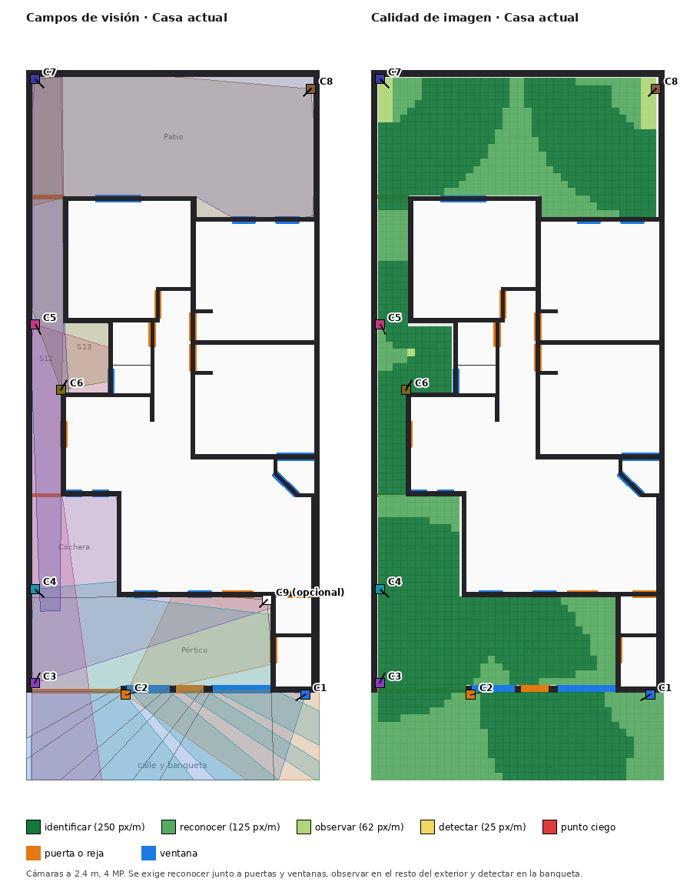
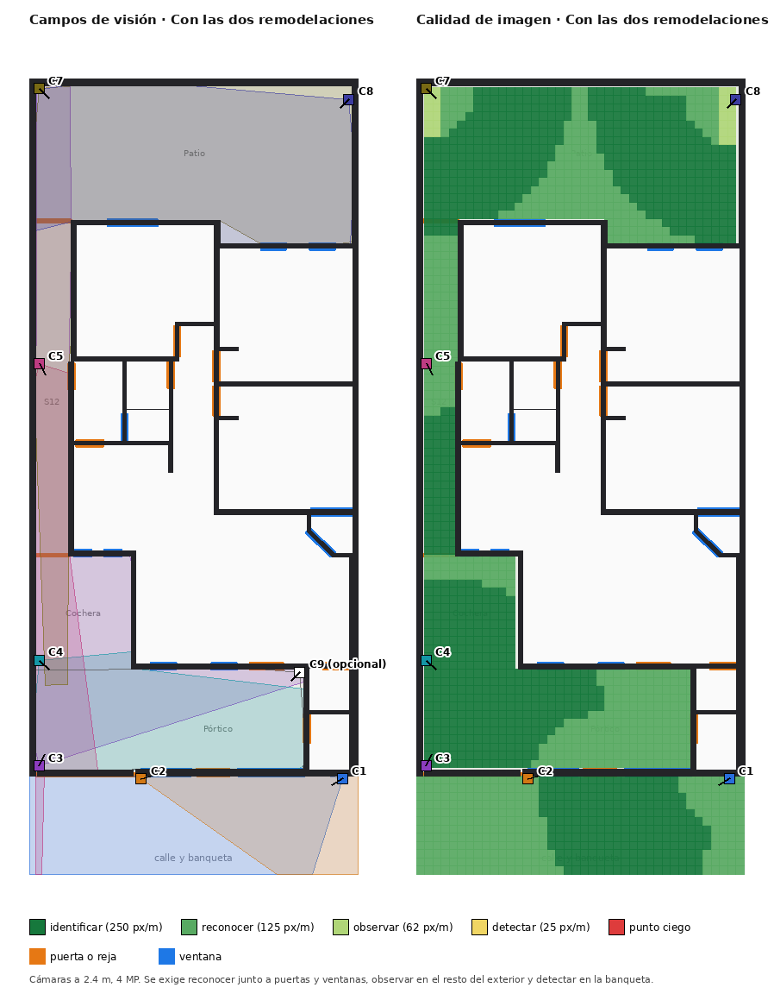

# 08 · Cámaras de seguridad exteriores

Análisis del modelo de la casa para ubicar cámaras en el exterior **sin puntos ciegos**. Es una **propuesta** (`variants/camaras-exterior/plan.json`): no modifica los hechos de `existing.*`. Se calcula con `house_twin/security.py` y se regenera con `python -m house_twin.cli cameras`.

## 1. Diagnóstico de la casa

- **Accesos a vigilar**: portón y reja de la cochera, puerta principal, bodega y medio baño (todos dan al pórtico), puerta de la cocina y de la lavandería hacia el pasillo de servicio, y las ventanas de recámaras y baño hacia el patio y el pasillo.
- **Cochera y pórtico son un solo espacio abierto** al frente: una cámara que lo domina cubre las tres puertas de la entrada.
- **Zonas naturalmente ocultas**: el pasillo de servicio (angosto, con muros que tapan la lavandería y la ventana del baño) y el patio trasero (grande, con las esquinas al pie de cada cámara).
- **No se puede cubrir desde fuera**: el tragaluz S08 y el techo.
- **Con la fachada moderna** el portón de lámina y las rejas cerradas esconden casi todo el exterior de la calle (1.1 % visible frente a 55.5 % hoy, suponiendo que la herrería actual deja ver), pero también la cochera queda sin vista desde afuera: hay que vigilarla desde dentro.

## 2. Método

- Línea de vista en 2D contra los muros (opacos a cualquier altura) y las ventanas (opacas); la herrería actual (D01, V11, V12) deja ver, en la fachada moderna es sólida.
- Cuadrícula de 0.25 m sobre todo el exterior de la casa más 3 m de banqueta y calle.
- Calidad de imagen en píxeles por metro (EN 62676-4, DORI): detectar 25, observar 62, reconocer 125, identificar 250 px/m. Sensor de 4 MP (2688 px), lentes de 2.8, 4 y 6 mm (100°, 85° y 55°).
- Exigencia: **reconocer** junto a cada puerta y ventana, **observar** en el resto del exterior, **detectar** en la banqueta.
- Montaje a 2.4 m, objetivo a 1.6 m (rostro) y 1.5 m de distancia mínima al piso: bajo la cámara hay una zona muerta, por eso **cada cámara tiene su pie cubierto por otra**.
- Búsqueda voraz (`suggest`) del mínimo de cámaras, ajustada a mano para evitar dos cámaras en el mismo poste (un solo punto de falla).

## 3. Cámaras propuestas

| Id | Posición (m) | Rumbo | Lente | Para qué |
|---|---|---|---|---|
| C1 | 9.56, -0.10 | 210° | 4 mm | Banqueta, fachada y reja peatonal de lado; ve el portón desde 9 m |
| C2 | 3.42, -0.10 | 15° | 2.8 mm | Mira a lo largo de la fachada; cubre el pie de C1 y la banqueta frente al pórtico |
| C3 | 0.30, 0.30 | 60° | 4 mm | Cochera y pórtico desde el portón hacia dentro (en la cara interior de la barda) |
| C4 | 0.30, 3.52 | 315° | 2.8 mm | Cara interior del portón y frente del pórtico; cubre el pie de C3 |
| C5 | 0.30, 12.56 | 300° | 4 mm | Recorre el pasillo: puerta de la cocina, lavandería y reja de la cochera |
| C6 | 1.21, 10.33 | 60° | 2.8 mm | Lavandería y ventana del baño (**solo en la casa actual**: con la cocina en U la lavandería se cierra) |
| C7 | 0.30, 20.95 | 315° | 2.8 mm | Patio en diagonal, ventanas de recámaras 1 y 2 |
| C8 | 9.76, 20.63 | 225° | 2.8 mm | Patio desde el lado opuesto; cubre el pie de C7 |
| C9 | 8.26, 3.15 | 225° | 2.8 mm | **Opcional**: segunda vista de la entrada desde el lado opuesto a C3 |

## 4. Resultados

| Escenario | Cámaras | Celdas ciegas | Peor acceso (px/m) |
|---|---|---|---|
| Casa actual | 8 (C1–C8) | **0** de 1916 | D09: 130 |
| Cocina en U | 7 (sin C6) | **0** de 1862 | D14: 126 |
| Fachada moderna | 8 | **0** de 1904 | D09: 130 |
| Las dos remodelaciones | 7 | **0** de 1850 | D14: 126 |

Todos los accesos quedan en «reconocer» o mejor. Redundancia (celdas vistas por 2 o más cámaras): 82 % en el pórtico (S11) y 84 % en la calle hoy; con la fachada moderna baja a 33 % y 29 %, porque el portón sólido tapa la vista. Con la **cámara opcional C9** la doble cobertura de cochera y pórtico sube de 49 % a 81 % con la fachada moderna (de 71 % a 86 % sin ella). Las pruebas (`tests/test_security.py`) fijan que quitar C5 o C7/C8 deja puntos ciegos.

Qué cambia con las remodelaciones: se retira C6; C3 y C4 siguen funcionando detrás del portón; con el portón sólido, la calle ya no ve el interior de la entrada y la vigilan las cámaras de dentro.

## 5. Recomendaciones

- **Timbre con video en D03** (puerta principal): queda en «reconocer»; un timbre da «identificar» a la distancia de la visita.
- Máscaras de privacidad hacia los vecinos y la vía pública; revisar la normativa local.
- Cámaras de carcasa antivandálica a 2.4 m, PoE a un NVR dentro de la casa, y vista infrarroja: la luz cálida de la fachada nueva no debe apuntar a los lentes (deslumbra).
- El tragaluz S08 y el techo se cubren con un sensor de apertura o rejilla, no con cámara.

## 6. Límites

Supuestos: sensor de 4 MP, muros y ventanas opacos, altura de la barda no medida, sin árboles, autos ni muebles, sin modelo de inclinación vertical. Es una guía de diseño: la ubicación final debe confirmarse en sitio con un instalador, y cableado, alimentación y normativa quedan fuera de este cálculo.
