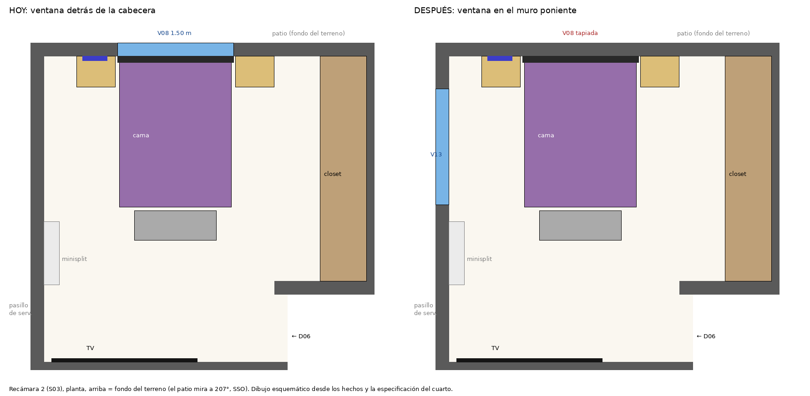

# 08 — Remodelación: ventana de la recámara 2 al muro del pasillo (propuesta)

Tercera remodelación del gemelo. Es una **propuesta**: vive en `variants/recamara-2-ventana.json` y no modifica los hechos
ni `models/existing.*`. «Recámara 2» es la que el proyecto rotula así (S03, la del closet de 4 módulos); el dueño le dice
«recámara 2» a la mayor (S02, rotulada RECAMARA 1), que no es esta.

## Lo que pidió el dueño (2026-10-25)

Reubicar la ventana que queda detrás del respaldo de la cama, después de investigar en Internet lo técnico y diseños de inspiración.

## Lo que dice el modelo de la casa

| Elemento | Hoy |
|---|---|
| Recámara 2 (S03) | 15.26 m², x = 1.45–5.62, y = 12.815–16.775 m. Puerta D06 (0.88 × 2.10 m) en el entrante del lado sur-oriente. |
| V08 | Ventana de 1.50 × 1.22 m, antepecho 0.86 m, en W09 (muro del patio), x = 2.40–3.90 m. Es **12 %** de la superficie del cuarto; con corrediza de 2 hojas, la parte que abre es ≈ 6 %. |
| Cama (fotos del dueño) | Cabecera contra W09, centrada bajo V08 (x ≈ 3.15 m): cama de 1.45 × 1.95 m, cabecera acolchada de **1.50 m de ancho y 1.25 m de alto**, 2 buros de 0.50 m. |
| Lo que pasa | La cabecera mide lo mismo que la ventana y es 0.39 m más alta que el antepecho: tapa el tercio de abajo del vidrio y las hojas quedan detrás de la cama. |
| Muros | W09 (patio, rumbo 207°, SSO), W12 (poniente, da al pasillo de servicio de 1.08 m hasta la barda; rumbo 117°, ESE), muro sur con la lavandería y el baño, y el este lo ocupa el closet (F02). **Solo W09 y W12 dan al exterior**. |
| En W12 | Contacto C12 (y = 14.57 m) y el minisplit sobre él (y = 13.82–14.64 m, z = 2.15–2.44 m). Sin ventanas. |

## Investigación

### Diseño: ventana y cabecera

- **Lo que se repite:** una cama frente a una ventana tiene tres costos: corrientes y frío, sol de la mañana por las rendijas
  y no poder abrir ni cortinar con facilidad ([Livingetc](https://livingetc.com/advice/bed-in-front-of-window),
  [Homes & Gardens](https://homesandgardens.com/interior-design/how-to-style-a-bed-in-front-of-a-window)). Las reglas de
  oficio: que la cabecera no tape más de tres cuartas partes del vidrio, y separar la cama 10–15 cm de la ventana si hay cortina.
- **Si la cabecera cubre las hojas** no se puede ventilar: el mismo problema que tiene hoy V08
  ([Hola](https://www.hola.com/decoracion/20200227161071/decoracion-dormitorios-ideas-colocar-cama-delante-ventana/)).
- **Soluciones a las que se llega:** centrar la cama entre dos ventanas o dejar la ventana a un lado
  ([Hunker](https://www.hunker.com/13403288/how-should-your-bed-be-positioned-in-a-bedroom)), cabecera baja o ventana alta
  ([Homes & Gardens](https://homesandgardens.com/interior-design/how-to-style-a-bed-in-front-of-a-window)), y usar apliques de
  pared en vez de lámparas de buro ([Livingetc](https://livingetc.com/advice/bed-in-front-of-window)) o un revestimiento acolchado
  en la parte baja del muro ([Hola](https://www.hola.com/decoracion/20200227161071/decoracion-dormitorios-ideas-colocar-cama-delante-ventana/)).
- **Medidas de uso** ([Houzz](https://www.houzz.in/ideabooks/111921842/thumbs/what-are-the-key-dimensions-for-a-well-planned-bedroom),
  Hunker): 61 cm libres en el lado por donde se hace la cama, 91 cm de circulación y buros a la altura del colchón.

### Técnica: abrir y tapiar vanos en un muro de block

- **Corte:** marcar el vano en las dos caras, marcar una franja para el dintel, cortar el contorno con sierra de disco para
  mampostería (≈ 5 cm de profundidad por lado) y romper hacia adentro; donde el corte abre celdas de block, se rellenan con mortero
  para tener un canto sólido ([Hunker](https://www.hunker.com/13416824/how-to-put-a-door-into-a-concrete-block-wall)).
- **Dintel:** de acero o de concreto, centrado sobre el vano y apoyado a ambos lados; el artículo de Hunker usa 15 cm de apoyo
  (6 in) y recomienda consultar a un ingeniero estructural antes de cortar. En block, la hilada superior lleva varilla corrida
  y varillas verticales a los lados ([Fine Homebuilding](https://finehomebuilding.com/forum/new-lintel-in-block-wall)).
- **Lo que no pude confirmar:** las NTC de mampostería de la CDMX (2017) tienen los apartados 5.1.1 «Castillos y dalas» y 5.1.3
  «Muros con aberturas», pero no conseguí su texto ([PAOT](https://paot.mx/centro/normas_a/2022/7.pdf) solo trae el índice).
  **No inventé** requisitos de castillos ni longitudes de apoyo: quedan para el ingeniero, junto con el reglamento de la ciudad de la casa.
- **Luz y ventilación, como referencia:** las NTC de la CDMX piden ventana del 17.5 % del piso y ventilación del 5 % en locales
  habitables (según el [instructivo de la UNAM](https://dgire.unam.mx/images/instructivo/Anexo17.pdf)); no sé si aplican en la
  ciudad de la casa y el documento no clasifica recámaras. Con el mismo vano (12 % y ≈ 6 % ventilado), la propuesta queda
  igual que hoy.

## Opciones

| | Qué es | A favor | En contra |
|---|---|---|---|
| **A (propuesta)** | V08 se tapia; la misma ventana pasa a W12, al lado de la cama | Cabecera y muro liso, mismo vano, **no cabe otra pared** sin tocar el closet ni la lavandería | Pierde la vista al patio; da a un pasillo de 1.08 m; ESE en vez de SSO |
| B | V08 se tapia y se abren 2 ventanas de ≈ 0.75–0.80 m a los lados de la cabecera, en W09 (x = 1.55–2.30 y 4.05–4.85) | Conserva patio y luz SSO; es el «ventanas a ambos lados» de las referencias | Dos vanos nuevos, quedan sobre los buros, el espejo se muda y la de la derecha casi toca el closet (5.02 m) |
| C | Subir el antepecho de V08 a ≈ 1.55 m, sobre la cabecera (1.25 m) | Sin tapiar ni abrir muros nuevos | No «reubica» nada: sigue detrás de la cabecera |

W12 es la única pared libre donde cabe una ventana igual a V08; la A es la más sencilla de obra (un vano que se corta y
otro que se rellena con casi el mismo número de blocks) y la implementada.

## La propuesta (A)

- **V08 se tapia** con block del espesor del muro (0.17 m), con aplanado y pintura como el resto del cuarto. La cabecera queda sobre un
  muro liso de 4.17 m (espacio para apliques o un panel acolchado; **no modelado**).
- **V13** (nueva, en W12): 1.50 × 1.22 m, antepecho 0.86 m, corrediza de aluminio negro con vidrio claro, **igual a V08** (marco y
  vidrio se toman de los mismos materiales). y = 14.85–16.35 m, a la altura del cerramiento de las puertas (0.86 + 1.22 = 2.08 m).

### Por qué ahí (y = 14.85–16.35 m)

| Revisión | Resultado |
|---|---|
| Esquina con W09 | 0.425 m desde el borde del vano a la cara interior de W09: espacio para el castillo de esquina |
| Contacto C12 | Queda 0.28 m al sur del borde; **verificar** en obra que el castillo del vano no lo toque |
| Minisplit | Termina en y = 14.64 m y está en z = 2.15–2.44 m, sobre el vano (2.08 m): no se cruzan |
| Cama y buro izquierdo | La ventana queda a un lado de la cama; el buro (x = 1.875–2.375 m) y el espejo no se tocan |
| Hojas | Corredizas: no barren el cuarto ni el pasillo de servicio (una abatible chocaría con él) |
| Cilindro de gas (propuesta `cocina-en-u`) | Va en y ≈ 12.95 m, a 1.9 m del borde de V13 |
| Luz y ventilación | Mismo vano: 12 % del piso, ≈ 6 % ventilado |

### Sol (con la orientación medida por el dueño: la fachada mira a 27°)

- V08 miraba a **207° (SSO)** y V13 mira a **117° (ESE)**: el cuarto cambia de sol de la tarde a sol de la mañana.
- Con el sol de media mañana de octubre que usa el recorrido (150°, 50° de altura), el rayo que sale de la ventana hacia el sol sube
  1.5 m al llegar a la barda: si ésta mide **menos de ≈ 2.4 m** entra sol directo por todo el vidrio; si pasa de ≈ 3.6 m, no entra a esa hora.
  **La altura de la barda no está medida.**
- Las ventanas de la casa traen caja de persiana enrollable (foto del dueño): conviene una en V13 (no modelada).

## Pendientes y límites

- **Medir:** altura de la barda (decide el sol), posición del castillo cerca de C12, y si la hoja corrediza se instala con el mismo perfil.
- **Estructura (U03 sigue sin respuesta):** se desconoce si W09 y W12 cargan. El vano nuevo y el tapiado necesitan dintel, castillos y
  repisón diseñados por un profesional; esta propuesta no los define.
- **Sin modelar:** persiana, cortina, apliques, el acabado del muro tapiado y el panel de cabecera. Los muebles se quedan donde están.
- **Recorrido 3D:** `build` ya genera los hechos propuestos y el IFC (`models/variants/recamara-2-ventana.ifc`); falta correr
  `python -m house_twin.cli scene` con Blender para su modelo en el selector «Versión» (aquí no hay Blender).
- **La planta de este informe** se dibujó a partir de los hechos y de `recamara-s03.json`; no sale de `build`.
