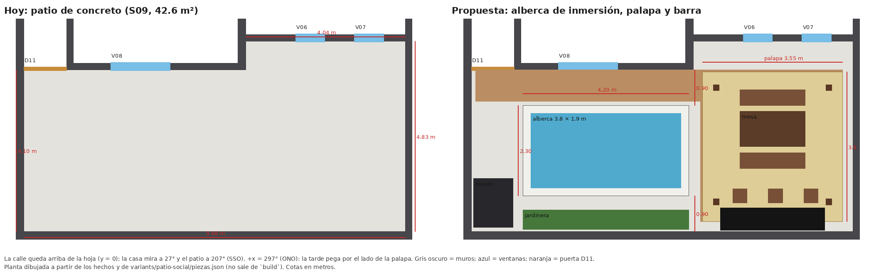
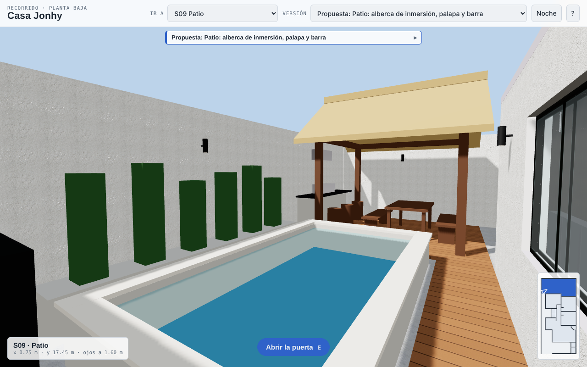
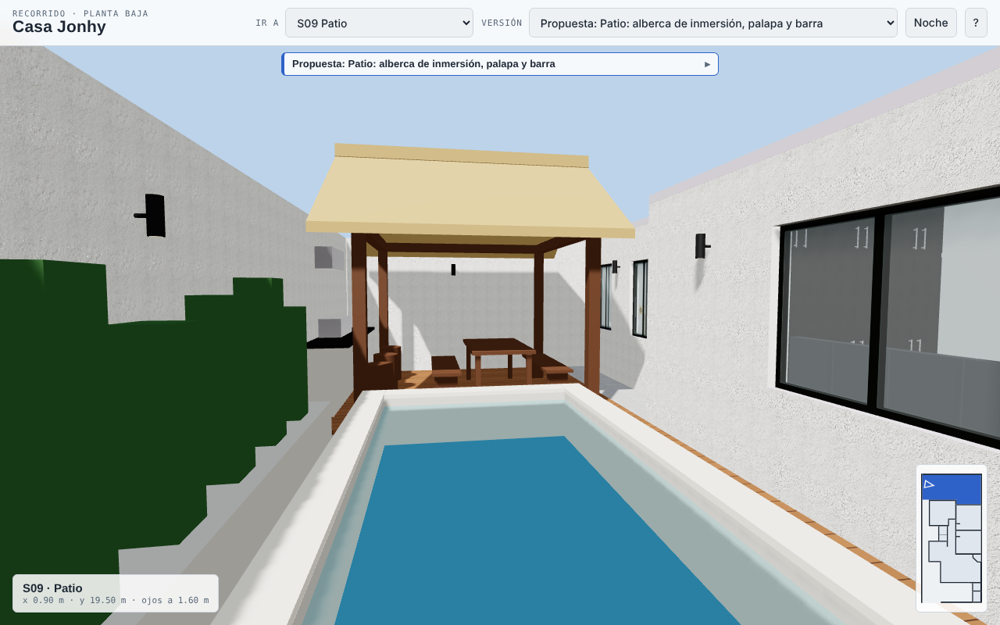
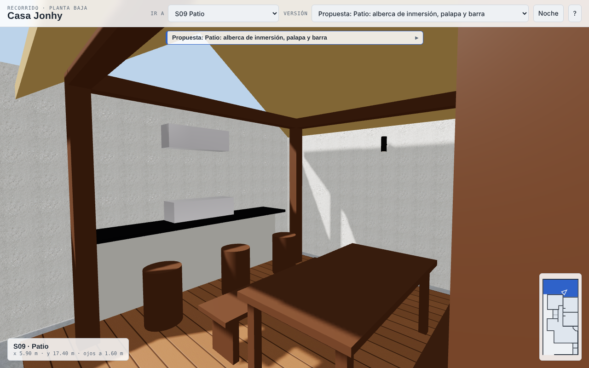
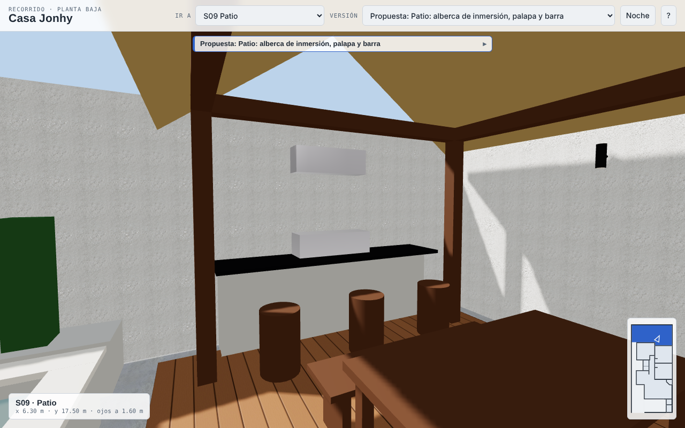
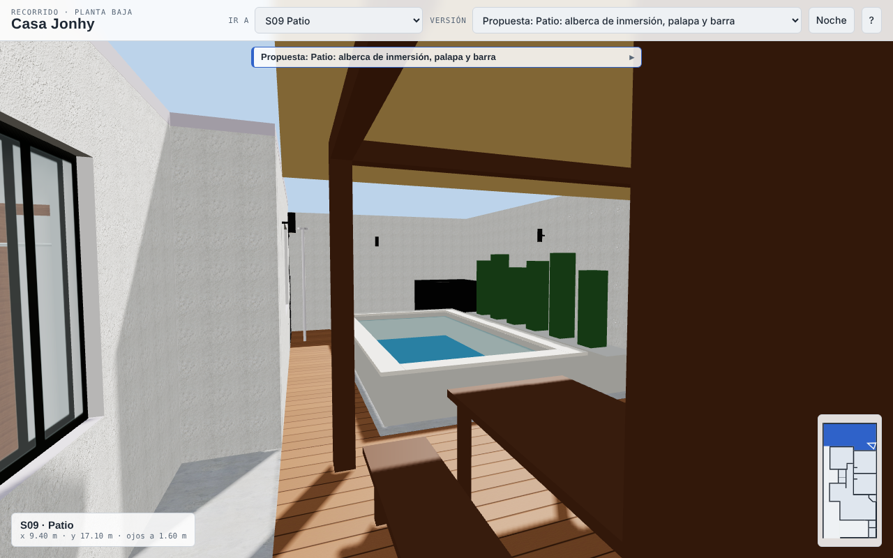

# 09 — Remodelación del patio: alberca de inmersión, palapa y barra (propuesta)

Cuarta remodelación del gemelo. Es una **propuesta**: vive en `variants/patio-social.json` y `variants/patio-social/piezas.json` y no
modifica los hechos ni `models/existing.*`. Es independiente de las propuestas de la recámara 2 (08), aunque se tocan (ver «Cruces»).

## Lo que pidió el dueño (2026-10-25)

Investigar en Internet las normas para construir albercas; analizar las medidas levantadas del patio; investigar diseños de palapas
o patios como área social; y con todo eso proponer la remodelación del patio.

## 1. Normas para albercas

**Lo que sí encontré sobre México**

- **NOM-245-SSA1-2010** (requisitos sanitarios y calidad del agua de las albercas; DOF 25/6/2012,
  [texto](https://platiica.economia.gob.mx/wp-content/uploads/sites/2/PDF_Normas_Publicas/245ssa12010.pdf)). Su numeral 1.2 la limita a albercas de
  centros vacacionales, clubes, balnearios, escuelas, hoteles, desarrollos turísticos y parques acuáticos «o cualquiera que preste un servicio
  público»: **una alberca residencial privada no queda claramente dentro**. No da medidas de diseño (profundidades, pendientes, andadores,
  cercado). Sí da los parámetros de agua que conviene tomar como referencia: cloro libre residual 1.0–5.0 mg/L, pH 6.5–8.5, turbidez
  ≤ 5 UTN, renovación de al menos 5 % del agua al día, circulación con equipo de filtración (5.7) y acabados sanitarios sin moho (5.6).
  La [guía sanitaria de Puebla](https://ss.puebla.gob.mx/images/areas/dpris/Guias/BSYP/003%20Albercas.pdf) tiene el mismo alcance (servicio público).
- **Reglamento de Construcciones de la CDMX** ([versión 2021 de la PAOT](https://paot.org.mx/centro/reglamentos/df/pdf/2021/RGTO_CONSTRUCCIONES_19_04_2021.pdf)):
  en lo que alcancé a leer, el art. 36 fr. III inciso a) pide la responsiva de un **Corresponsable en Instalaciones** para «albercas con
  iluminación subacuática» al registrar la manifestación de construcción, y el art. 51 fr. I inciso f) pone las cisternas, fosas sépticas y
  albañales como manifestación tipo A. El texto que obtuve se corta en el art. 53, así que **no puedo afirmar** que no haya otras reglas
  (retiros, desagüe, seguridad). **No sé en qué ciudad está la casa**: el reglamento aplicable puede ser otro.
- **Precios de referencia** ([Habitissimo, CDMX](https://www.habitissimo.com.mx/presupuesto/construccion-alberca/ciudad-de-mexico)): promedio
  $317,667 MXN (mínimo $180,000, máximo $493,000) y una alberca de concreto de 6 × 12 × 1.6 m en $336,000. No hay precio por m² publicado ni
  qué incluye: **no estimé el costo de esta alberca**; se necesitan cotizaciones.

**Lo que no es norma mexicana (referencias internacionales, para orientarse)**

No encontré una norma mexicana con cercado, retiros o drenes de albercas residenciales. Estas son reglas de municipios de EE. UU. basadas en sus
códigos modelo; sirven de criterio, **no son obligatorias aquí**:

- **Barrera:** 48 in (1.22 m) de alto, sin aberturas que pasen una esfera de 4 in (10 cm), puertas que abran hacia afuera, con cierre y
  pestillo automáticos y manija a ≥ 54 in (1.37 m); si una puerta o ventana de la casa da a la alberca, alarma o cobertura de seguridad
  ([Spokane County](https://www.spokanecounty.gov/DocumentCenter/View/59232/BP-17-Residential-Swimming-Pools-Spa-and-Hot-Tub-Barriers),
  [Celina, TX](https://www.celina-tx.gov/DocumentCenter/View/5680/Pool-Packet-)).
- **Retiros y excavación:** 5 ft (1.52 m) del borde de la excavación a cimientos, muros de retención y colindancias; si la profundidad pasa de
  5 ft, una distancia igual a la profundidad; más cerca, carta e inspección de un ingeniero (Celina). Los informes geotécnicos suelen prohibir excavar
  bajo una línea a 45° desde el borde inferior de la zapata existente salvo con apuntalamiento o recimentación, y la excavación puede fallar aun
  fuera de esa línea por el empuje lateral ([Structure](https://structuremag.org/wp-content/uploads/2014/09/D-From-Experience1.pdf)).
- **Drenes:** si hay dos drenes principales, a ≥ 3 ft (0.91 m) entre sí, con tapas certificadas ANSI/ASME A112.19.8; con un solo dren, un sistema
  secundario (liberación de vacío, etc.); la CPSC recomienda incluso no tener drenes y alimentar la bomba desde skimmers o rebosaderos
  ([CPSC](https://www.poolsafely.gov/wp-content/uploads/2016/04/PSSA-Staff-Guide.pdf), Celina). Descarga de retrolavado con espacio de aire; protección
  contra reflujo en la toma de agua; tubería inspeccionada antes de rellenar.
- **Eléctrico:** inspección de la unión equipotencial (bonding) y de las canalizaciones subterráneas (Celina, según el NEC 2023). En México aplica la NOM-001-SEDE,
  **que no revisé**.

## 2. Medidas del patio (S09)

Salen de `data/facts/existing.facts.json` (plano DXF, caras interiores de muros; el nombre «Patio» lo dio el dueño el 2026-10-08).

| Dato | Valor |
|---|---|
| Superficie | 42.58 m² (perímetro 28.98 m) |
| Forma | un rectángulo de **9.66 × 4.10 m** (x = 0.20–9.86 m, y = 16.945–21.05 m) más un **entrante de 4.04 × 0.73 m** (x = 5.82–9.86 m, y = 16.22–16.945 m) |
| Orientación | la casa mira a 27°: el patio mira a **207° (SSO)**; el lado largo corre ESE–ONO y el extremo «oriente» del plano (x = 9.86 m) es en realidad el **ONO (297°)** |
| Muros | Poniente W01 (x = 0.20), sur W02 (y = 21.05) y oriente W05 (x = 9.86) son la barda; norte, la casa: W09 (recámara 2, y = 16.945) y W10 (recámara mayor, y = 16.22) |
| Vanos | **D11**: puerta de herrería de 1.08 m al pasillo de servicio (x = 0.20–1.28), la única entrada. **V08** (recámara 2, 1.50 m, x = 2.40–3.90) y **V06/V07** (recámara mayor, 0.735 y 0.75 m, x = 7.085–7.82 y 8.57–9.32), todas con antepecho de 0.85–0.86 m |
| Piso | concreto escobillado gris (confirmado por el dueño) |

**Desconocido** (el plano no lo dice; no lo inventé): nivel del piso, si hay techo, **alturas de la barda** (en el modelo se dibuja a 2.6 m por la
altura de entrepiso: es un supuesto), **cimentación de la barda y de la casa**, tipo de suelo, desagües y pendientes del piso, **dónde están la cisterna,
el albañal y las tomas de agua y luz**, si hay servidumbres y la ciudad.

**Qué implican las medidas**

- El patio es largo y poco profundo: 4.10 m de fondo. Una alberca de 1.9 m de ancho (interior) deja ≈ 0.9 m a cada lado, justo el mínimo de paso
  (91 cm, [Houzz](https://www.houzz.in/ideabooks/111921842/thumbs/what-are-the-key-dimensions-for-a-well-planned-bedroom)). Cumplir los 1.52 m de retiro de arriba a ambos lados es **imposible**: la excavación queda a ≈ 0.9 m de dos muros.
- La entrada es por la esquina noroeste: lo que queda al fondo (oriente) está a ≥ 6 m de la puerta.
- **Sol** (cálculo propio, latitud de referencia 19.4° N como la CDMX —**la ciudad no está en el repo**—, hora solar, y barda de 2.2 / 2.6 / 3.0 m, sin medir):
  horas de sol directo en el centro de la alberca: 21 jun ≈ 9 h; 26 oct 6 / 5 / 4 h; 21 dic 4.5 / 3 / 1.75 h. En el lugar de la palapa, sin techo: 26 oct 8 / 7 / 6 h.
  La tarde pega por el sur-ONO, o sea por el extremo de la palapa.

## 3. Diseños: palapas y patios como área social

- **Palapa:** estructura abierta de postes y vigas de madera con techo de palma seca atada con alambre; llegó a la Nueva España desde Filipinas
  ([Wikipedia](https://en.wikipedia.org/wiki/Palapa_(structure))). Pendiente suave, madera sellada o barnizada contra la pudrición, mantenimiento bajo pero
  con reposición de palma; **mal suelo para viento fuerte y lluvia intensa**: la palma se afloja, se empapa y pesa; las alternativas son pérgolas
  o techos de lámina/policarbonato ([AIBD](https://aibd.org/palapa-or-tiki-hut/)). Cuadrada = más sombra, rectangular = pasillos y comedores.
  Otras cubiertas de patio: policarbonato (luz sin calor, protege de lluvia y granizo), pérgola de madera (abierta, o con tela o plantas), lámina y cristal templado
  ([TV Azteca](https://www.tvazteca.com/aztecauno/estilo-de-vida/4-ideas-techo-para-tu-patio-y-hacer-casa-se-vea-elegante-y-aesthetic/)).
  No encontré una norma mexicana para el tratamiento ignífugo de la palma.
- **Alberca en patio chico:** una alberca de inmersión de ≈ 3–6 m × 1.8–4.6 m cabe en un lote chico; rectangular o cuadrada cuesta menos y
  aprovecha el espacio; un lado de andador más ancho funciona mejor que márgenes iguales; bancas o repisa sumergidas ahorran deck; sombra desde el inicio;
  vegetación de crecimiento controlado y sin hojas que caigan al agua; piso antiderrapante y paleta de pocos materiales; equipo lejos de donde se sienta la gente
  ([ArchitectGPT](https://www.architectgpt.io/blog/plunge-pool-design-small-lots-big-impact), [Yardzen](https://yardzen.com/amenities-elements/top-10-small-backyard-pool-ideas),
  [Bob Vila](https://www.bobvila.com/articles/plunge-pool-cost/): una alberca de inmersión típica tiene 5½–7 ft de profundidad).
  Variantes que me sirvieron: la alberca **semienterrada** (ahorra excavación), la de **banca** tipo «cocktail pool» y la cubierta que convierte el
  agua en patio (idea 10 de Yardzen; no la adopté).

## 4. La propuesta

Tres zonas de poniente a oriente, todas sobre un andador de deck y con la entrada actual (D11):

1. **Entrada** (x = 0.2–1.5 m): regadera exterior (tubo de acero inoxidable) y **caseta de equipo** de 1.00 × 1.25 × 1.10 m en la esquina sur-poniente.
2. **Alberca de inmersión semienterrada** (x = 1.50–5.70 m, y = 17.85–20.15 m): muros de concreto armado de 0.20 m, **0.50 m sobre el piso y 0.80 m bajo él**;
   interior de **3.80 × 1.90 m = 7.22 m²**, agua a 1.22 m de profundidad = **≈ 8.8 m³ (≈ 8.8 t de agua)**, borde de piedra o porcelanato claro de 4 cm, fondo
   de mosaico azul. Al **norte** un andador de deck de 0.90 m (WPC nogal, la duela de la casa); al **sur** una jardinera de concreto de 0.50 m con pastos de 1.0–1.3 m.
3. **Palapa** de postes de madera tratada de 0.15 m (x = 6.40 y 9.25 m, y = 17.40 y 20.30 m) y **techo de palma tratada a dos aguas** (x = 6.05–9.60 m,
   y = 17.0–20.8 m; alero a 2.35 m y cumbrera a 3.60 m): **comedor exterior para 6** (mesa de 1.65 × 0.90 m y dos bancas) y, contra el muro sur, una **barra de
   concreto con cubierta de granito negro, 3 bancos altos y un asador de 0.90 m con campana** centrados bajo la cumbrera.
4. **Luz:** cinco arbotantes cálidos (3000 K, 10 W) a 2.0 m en los muros, como los de la fachada propuesta (se encienden en «Noche» del recorrido).

### Por qué así

| Decisión | Razón |
|---|---|
| **Semienterrada** | Excavar solo 0.80 m + la losa (≈ 1.0 m en total) en vez de 1.4 m o más reduce el riesgo junto a los muros; el borde de 0.50 m sirve de asiento |
| **Profundidad de 1.22 m** | Alberca de convivencia para pararse, no de nado: más segura con niños; las de inmersión típicas son más hondas (Bob Vila) y esta no lo pretende |
| **Alberca al centro-poniente, palapa al fondo** | La palapa da sombra donde pega el sol de la tarde (sur-ONO); la alberca recibe el sol de mediodía y de la mañana (≈ 5 h el 26 de octubre con barda de 2.6 m) |
| **Alberca a ≥ 0.9 m de cada muro** | Lo que cabe: 0.905 m al norte y 0.90 m al sur; trabajo y mantenimiento de impermeabilización |
| **Barra y asador al sur, bajo la cumbrera** | La campana queda a ≥ 0.9 m del techo de palma (probado); la zona de fuego lejos de los postes; la palma tratada **no sustituye** la revisión del proveedor |
| **Techo de palma a dos aguas con alero a 0.26 m de la colindancia** | Para que no gotee en el vecino; deja ≥ 0.7 m a las ventanas de la recámara mayor |
| **Sin cercado propio** | El patio ya está cerrado por la barda: el riesgo viene por la casa (ver pendientes) |

El recorrido con texturas se generó como el de la propuesta 08 (`bpy` y un cargador mínimo del IFC en lugar de Bonsai; sin luces ni renders de Cycles).
Para que el recorrido pinte las piezas de la propuesta se agregaron a `blender_scene.py` las clases `IfcColumn`, `IfcBeam`, `IfcRoof` e
`IfcBuildingElementProxy`; ninguna otra variante las usa. `extras` ganó `cylinders` (bancos, regadera) y la pendiente de un techo en y (`slope_axis`).

### Alternativas que descarté

| Opción | Qué es | Por qué no |
|---|---|---|
| Sin alberca | Palapa, deck, jardineras y regadera; sin excavar | Es la más barata y segura para los muros, pero pierde el objetivo de la alberca; sigue disponible quitando la alberca de `piezas.json` |
| Alberca de fibra de vidrio prefabricada | Cascarón de fábrica, instalación en días | Su tamaño comercial (≈ 3–4 m) cabe, pero igual excava y necesita grúa por un acceso de 1.08 m (la puerta D11); no lo verifiqué |
| Alberca más larga en el entrante | 4.04 × 4.83 m al oriente | Queda frente a las ventanas V06/V07 (antepecho 0.85 m) y deja la palapa sin lugar |

## 5. Cruces con otras propuestas

- **08 A (ventana de la recámara 2 a W12):** tapia V08, la ventana que queda a 0.905 m de la alberca. Con la A, esa ventana deja de dar al patio.
- **08 B (dos ventanas en W09):** V13 y V14 quedarían también a ≈ 0.9 m de la alberca, con antepecho de 0.86 m; habría que cerrarlas con seguro o alarma.
- **06 cocina en U y 07 fachada moderna:** no tocan el patio.

## 6. Pendientes y límites

- **Cimentación:** la barda y los muros de la casa tienen cimentación desconocida y la excavación queda a ≈ 0.9 m de ellos. Antes de cualquier decisión: **calas** de verificación, un
  **estudio de suelos** y el proyecto de un **ingeniero estructural**; la alberca debe ser una caja autoportante y no cargar ni empujar la barda.
- **Subpresión:** una alberca vacía puede flotar o fallar si el nivel freático sube; el proyecto debe revisarlo (no lo calculé).
- **Instalaciones:** ubicar cisterna, albañal, tomas de agua y luz; la alberca necesita reposición de agua, desagüe (a la red, no a la calle ni a la barda), bomba, filtro, clorador, **tierra física y unión equipotencial**; el reglamento de la ciudad puede pedir **Corresponsable en Instalaciones** si lleva luz subacuática (no modelada).
- **Seguridad:** las ventanas V06, V07 y V08 (antepecho 0.85 m) y la puerta D11 dan al patio. Propongo **seguros o alarma en las ventanas** y que D11 cierre sola con pestillo alto (≥ 1.37 m), según los criterios de arriba. Sin esto un niño llega al agua desde la casa.
- **Palapa:** la altura de 3.6 m rebasa la barda del modelo (2.6 m, supuesto); revisar **altura máxima y área libre** del uso de suelo (no consulté), la vista a los vecinos y el viento. La palma y la lluvia exigen mantenimiento y tratamiento ignífugo; el asador de gas necesita instalación de un profesional.
- **Sin modelar:** pendientes y drenaje del piso, el interior real de la alberca (el fondo queda a nivel del piso en el modelo; el agua se ve poco profunda), luz subacuática, skimmers y retornos, la banca sumergida, cubierta de seguridad, vegetación real, cortinas de privacidad.
- **Supuestos de medidas:** mesa, bancas, bancos y caseta con tamaños comunes; los materiales son colores sin foto (la duela sí es la de la casa).
- **Costo:** sin estimar (ver arriba). **No sustituye** el proyecto de un profesional ni el permiso.
- **La planta de este informe** se dibujó a partir de los hechos y de `piezas.json`; no sale de `build`.
