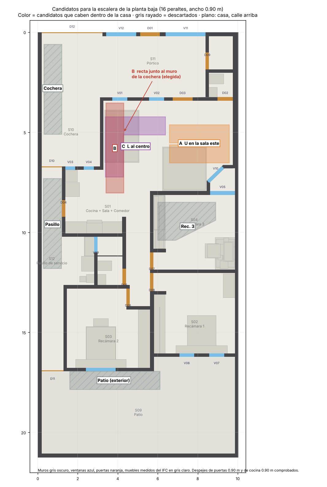
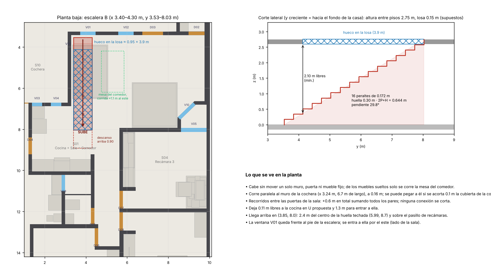
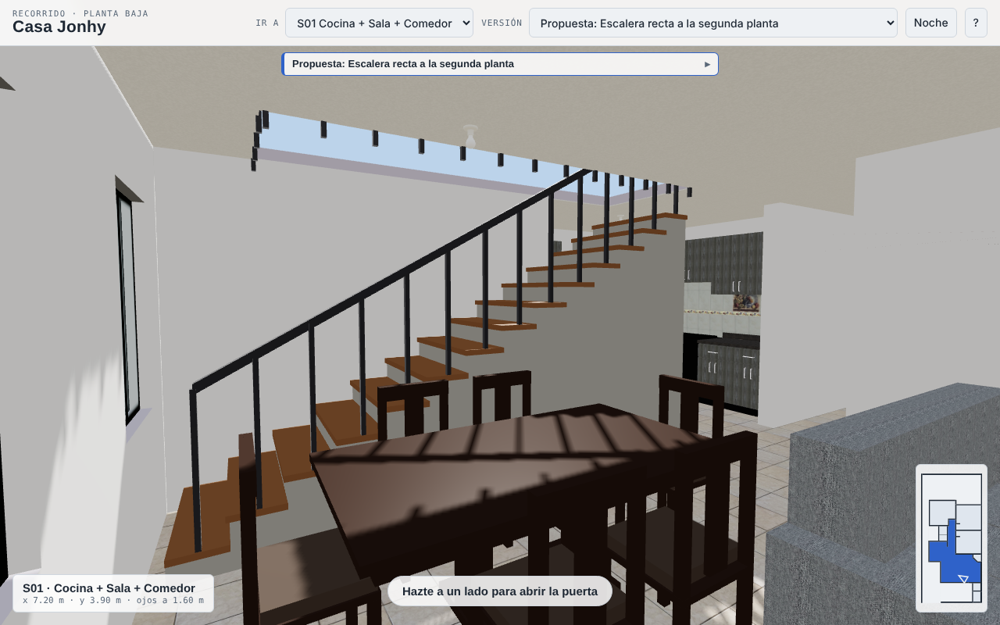
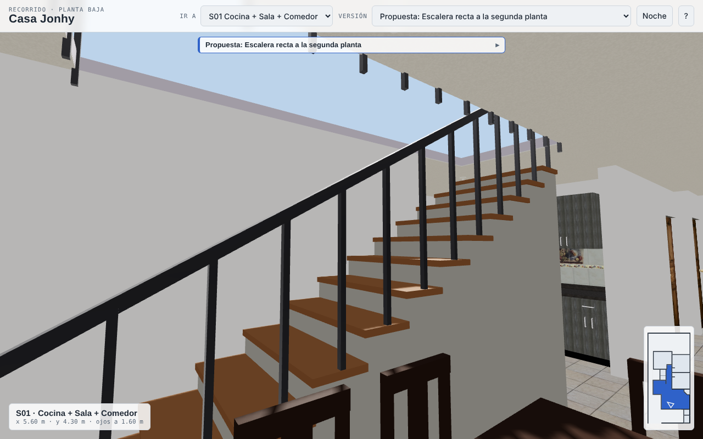
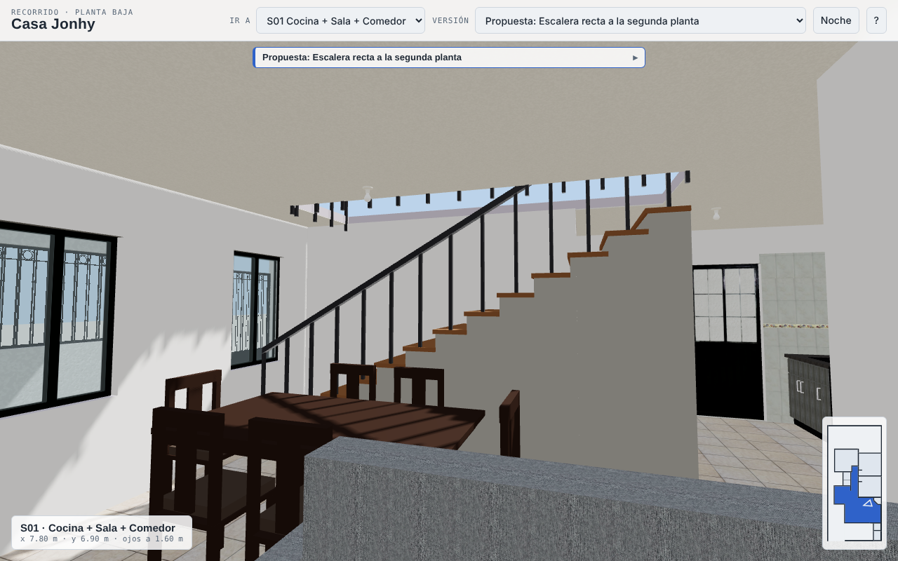
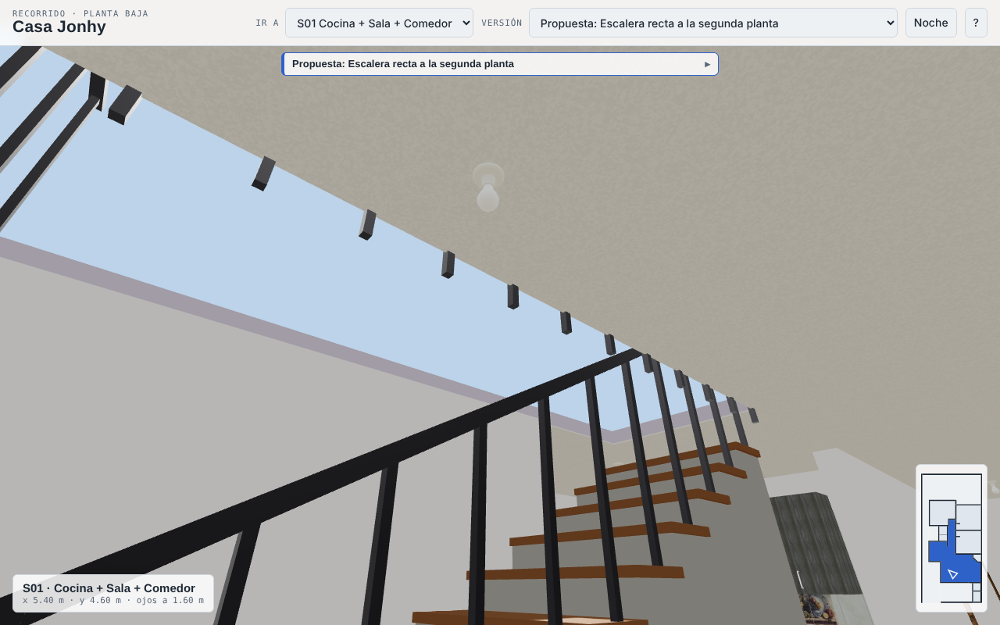

# 10 — Escalera para una segunda planta: dónde ponerla (análisis)

Es un **estudio de ubicación**, no una variante del modelo: no cambia los hechos ni `models/existing.*`, y todavía no hay
`variants/escalera-*.json`. Lo que se mide viene de `data/facts/existing.facts.json` y de los muebles de `models/existing.ifc`; lo que se supone
está marcado como supuesto. No sustituye el cálculo estructural ni la revisión de un profesional.

## Lo que pidió el dueño (2026-10-26)

Investigar técnicamente las escaleras, analizar a fondo los planos de la casa e identificar el lugar más óptimo para la escalera de una segunda planta.

## 1. Investigación técnica

| Tema | Lo que encontré | Fuente |
|---|---|---|
| Fórmula de Blondel | 2 peraltes + 1 huella = 63–65 cm; ejemplo «óptimo»: peralte 18 cm y huella 28 cm (64 cm) | [ArchDaily](https://www.archdaily.com/892647/how-to-make-calculations-for-staircase-designs) |
| Número de peraltes | altura entre pisos ÷ 18 cm, **redondeando hacia arriba**, y se reparte igual | ArchDaily |
| Ancho | mínimo 80 cm en vivienda unifamiliar (ArchDaily); 36 in (91 cm) libres arriba del pasamanos en el código residencial de EE. UU. | ArchDaily, [Saint Paul](https://www.stpaul.gov/DocumentCenter/Government/Safety%20%26%20Inspections/Construction%20Inspections/Building/Stairs%20and%20Handrails%202015_201502051412436774.pdf) |
| Peralte y huella (EE. UU.) | peralte máx. 7¾ in (19.7 cm), huella mín. 10 in (25.4 cm) | Saint Paul |
| Altura libre | 2.15 m (ArchDaily; Neufert da 2.00 m); 6 ft 8 in = 2.03 m (Saint Paul) | ArchDaily, Saint Paul |
| Descansos | uno cada 15 escalones (ArchDaily); fondo mínimo 36 in (91 cm) en el sentido de la marcha (Saint Paul) | ArchDaily, Saint Paul |
| Pasamanos | 80–90 cm (ArchDaily); 34–38 in (86–97 cm) (Saint Paul) | ArchDaily, Saint Paul |
| Hueco en la losa | hueco = (espesor de losa + altura libre) × recorrido ÷ altura total; avisa que cualquier hueco debilita la estructura | [Hunker](https://www.hunker.com/13412587/how-to-calculate-an-opening-for-stairs/) |

**Lo que no pude verificar:** el Reglamento de Construcciones y sus Normas Técnicas Complementarias de México (o de la ciudad de la casa, que **no sé cuál es**).
El sitio de la CDMX que encontré bloqueó la lectura, así que las cifras de arriba son referencias técnicas y de EE. UU., **no la norma que aplica aquí**.
Antes de dibujar planos de obra hay que revisar la norma local.

**Criterios de diseño que adopté** (supuestos, no hechos del plano): altura entre pisos 2.75 m con losa de 0.15 m (supuesto; la altura y el espesor son desconocidos, U02),
**16 peraltes de 17.2 cm**, huella 30 cm (2P+H = 64.4 cm, pendiente 29.8°), ancho 0.90 m, altura libre 2.10 m, despeje de 0.90 m frente a cada puerta y a la cocina.
El hueco sale de la fórmula de Hunker: (0.15 + 2.10) × 4.5 ÷ 2.75 = **3.7 m**; contando escalón por escalón (los dos primeros caben bajo la losa) da **3.9 m**, y uso 3.9 m.

## 2. Análisis de los planos

**Hechos** (plano DXF, medidas interiores):

- Huella techada de la planta baja: **≈ 128 m²** (x 1.21–10.03 m, y 0–16.95 m), centroide en **(5.99, 8.70)**. Se supone que una planta alta cubriría esa huella.
- La casa tiene 3 recámaras al fondo (S02, S03, S04), baño (S05), lavandería (S13), baño de visitas (S07) y bodega (S06). La entrada es por el pórtico (S11, D01) y la puerta D03 da directo a la sala.
- **S01 «Cocina + Sala + Comedor»** (42.9 m², x 1.38–9.76, y 3.42–13.7) es el único espacio grande y techado: la cocina al poniente, el comedor junto al muro de la cochera (mesa x 3.65–4.75 m, y 4.2–6.2 m) y la sala al oriente (sofá x 6.23–8.43 m, y 5.72–7.92 m).
- La cochera (S10) mide **2.92 m de ancho** y no está techada; el pasillo de servicio (S12) mide 1.08 m y es la **única ruta cochera–patio**; el pórtico (S11) tiene puertas y ventanas en todo su perímetro; el patio (S09) está descubierto.
- Muros en la colindancia: W01 (poniente), W04, W05, W06, W11 (oriente) y W02 (fondo). El muro entre cochera y sala (x ≈ 3.24 m, 6.7 m de largo) es el muro interior continuo más largo de la planta.

**Desconocidos que condicionan todo** (`unknowns`): **U02** tipo y espesor de losa, **U03** dónde hay castillos, trabes y muros de carga, **U05** material de los muros, y la altura entre pisos.

## 3. Método

1. Dibujé tres tipos de escalera (recta 0.9 × 4.5 m, en L de 3.0 × 3.0 m, en U de 1.9 × 3.0 m) en las 4 orientaciones y su espejo, y las probé cada 0.1 m en **todos los espacios mayores de 3.5 m²**.
2. Una colocación solo vale si queda dentro del espacio, no toca muros, no invade el despeje de 0.90 m de ninguna puerta y no pisa muebles fijos (cocina, closets, lavandería) ni el despeje de 0.90 m de la cocina.
3. En la sala-comedor, las que sirven (1,796 con paso 0.2 m) se compararon por: conexiones entre puertas cortadas, metros que se alargan los recorridos (ruta de menor costo en cuadrícula de 0.1 m, con 0.12 m de holgura a los muebles) y m² de mobiliario suelto (comedor con 0.6 m de holgura, sofá con 0.5 m) que habría que correr.

**Resultados por zona**

| Zona | ¿Cabe? | Por qué se descarta (o no) |
|---|---|---|
| Pórtico | no | los despejes de sus puertas lo ocupan todo |
| Cochera | sí, geométricamente | quedan 2.0 m de ancho: ya no entra un coche; sin techo y a la intemperie |
| Pasillo de servicio | sí, geométricamente | tapa la única ruta cochera–patio |
| Patio | sí | arrancaría contra el muro de las recámaras y choca con el patio social (09) |
| Recámaras | sí | se sacrifica una de 15 m² |
| Sala-comedor con **todas** las holguras de cocina, comedor y sofá | **ninguna** | hay que correr mobiliario suelto |
| Sala-comedor corriendo mobiliario suelto | **B, A y C** | ver abajo |

**Los tres finalistas**

| | Tipo y huella | Mobiliario suelto que se corre | Recorridos | Hueco en la losa | Llegada arriba |
|---|---|---|---|---|---|
| **B** recta junto al muro de la cochera | x 3.40–4.30, y 3.53–8.03 (4.05 m²) | 3.2 m² (el comedor) | +0.6 m en total | ≈ 0.95 × 3.9 m | (3.85, 8.0), a 2.4 m del centroide |
| **A** en U en la sala oriente | x 6.57–9.57, y 4.62–6.52 (5.5 m²) | 2.8 m² (el sofá) | +1.8 m | ≈ 4.5 m² | (8.07, 5.55), a 4.0 m |
| **C** en L al centro de la sala | x 3.37–6.37, y 4.22–7.22 (4.6 m²) | 3.8 m² | 0 | ≈ 5 m², en medio de la losa | ≈ (4.9, 5.7), a 3.2 m |

Ninguna corta una conexión entre puertas. Las cifras de A y C vienen del mismo barrido; el hueco de A y C es una estimación mía (huella menos los dos primeros escalones).

## 4. Matriz de decisión

Puntajes de 1 a 5 **a mi juicio** (no son medidas), con los pesos que me parecieron razonables: funcionalidad 25 %, estructura/losa 20 %, acceso a la planta alta 25 %, luz y clima 10 %, otras propuestas 10 %, costo/obra 10 %.

| Opción | Func. | Estr. | Acceso | Luz | Otras | Obra | **Total /100** |
|---|---|---|---|---|---|---|---|
| **B** recta junto al muro de la cochera | 4 | 4 | 5 | 4 | 4 | 4 | **85** |
| A en U, sala oriente | 3 | 3 | 3 | 3 | 4 | 3 | 62 |
| Sacrificar la recámara 3 | 1 | 3 | 5 | 2 | 4 | 2 | 58 |
| C en L, centro de la sala | 2 | 2 | 4 | 3 | 3 | 3 | 56 |
| Patio | 2 | 4 | 2 | 2 | 1 | 3 | 48 |
| Pasillo de servicio | 1 | 3 | 2 | 2 | 2 | 3 | 41 |
| Cochera | 1 | 4 | 1 | 2 | 1 | 3 | 38 |

**Sensibilidad:** con 20,000 juegos de pesos al azar y quitando un criterio a la vez, B queda primera siempre; B no pierde contra ninguna otra opción en ningún criterio (solo empata en algunos). Eso muestra que la elección **no depende de los pesos**, pero sí de mis puntajes; el que más pesa y menos conozco es el de estructura (depende de U02 y U03).

## 5. Recomendación: la escalera recta B

**Ubicación:** en la sala-comedor, paralela al muro entre la cochera y la sala (x 3.24 m): ocupa x 3.40–4.30 m, y 3.53–8.03 m, sube hacia el fondo de la casa y llega arriba en (3.85, 8.0).

**Por qué es la más óptima**

1. **Es la que menos estorba:** no mueve muros, puertas ni muebles fijos; solo hay que correr la mesa del comedor (≈ 1.1 m al este), y los recorridos entre puertas se alargan 0.6 m en total.
2. **Mejor llegada arriba:** queda a 2.4 m del centro de la huella y sobre el pasillo de las recámaras, con lo que la planta alta puede repetir ese pasillo.
3. **Mejor apoyo estructural probable:** corre junto al muro más largo de la planta y el hueco es angosto (0.95 m): si las viguetas van en la misma dirección del hueco, se cortan pocas.
4. **Un solo tramo**, sin descanso intermedio, y con la ventana V01 frente al pie.
5. **Compatible con las otras propuestas:** deja 0.11 m a la cocina en U (por eso va en x 3.40 m: más cerca del muro chocaría con la cubierta de esa cocina) y 1.3 m para entrar a ella. No toca el patio ni la cochera.

**Su costo:** 16 peraltes están justo en el límite para no pedir descanso (ArchDaily lo pide tras 15 escalones); si la altura entre pisos resulta mayor, habrá que añadir un descanso o pasar a una L. El pie se entra de lado, desde el este.

## 6. Qué falta confirmar

- **Altura entre pisos y espesor de losa (U02):** el número de peraltes y el hueco dependen de ellos.
- **Dirección de las viguetas y trabes (U03):** si cruzan el hueco, hay que hacer brocales o mover la escalera.
- **Si el muro de la cochera es de carga y de qué material (U03, U05).**
- **Norma local:** ciudad de la casa y su reglamento de construcciones.
- **Qué habrá arriba:** el análisis supone una planta alta sobre toda la huella techada; la cochera y el patio no se tocaron.
- **El comedor:** si el dueño prefiere no correrlo, la opción A es la segunda.

## 7. La propuesta en el modelo: `escalera-recta`

Para poder verla, la escalera quedó como variante (`variants/escalera-recta.json`; piezas en `variants/escalera-recta/piezas.json`,
comedor corrido en `variants/escalera-recta/sala.json`) y se elige en el selector «Versión» del recorrido (`#escalera-recta`).
No cambia los hechos ni `models/existing.*`.

- **Altura:** el modelo supone muro de 2.40 m y losa de 0.10 m (`ASSUMED_DEFAULTS`), es decir **2.50 m entre pisos**; la variante usa esa
  altura, no los 2.75 m del estudio: salen **15 peraltes de 16.7 cm** (14 escalones y el piso de arriba), huella 30 cm, 2P+H = 63.3 cm y un tramo de 4.2 m
  (y 3.53–7.73 m). Con 2.75 m serían 16 peraltes y 4.5 m; la ubicación no cambia.
- **Ancho:** 1.00 m (x 3.30–4.30 m), de concreto con huella de madera de 4 cm; balaustres y pasamanos de acero del lado abierto (este).
  Junto a la cocina en U hay que acortar 0.1 m la cubierta de la cocina o correr la escalera a x 3.40 m.
- **Hueco:** 1.12 × 3.70 m (x 3.24–4.36, y 4.03–7.73) en la losa y en el plafón de S01, con guarda de 1.0 m a su alrededor. Es la nueva clave
  `add_slab_openings` de la geometría de una variante. La losa de la casa hace de piso de la planta alta; la planta alta como tal no está modelada,
  por eso por el hueco se ve el cielo.
- **Comedor:** corrido 1.1 m al este (centro x 5.3 m). Queda a ≈ 0.1 m del sofá: conviene girar la mesa o correr el sofá 0.3 m.

| | |
|---|---|
|  |  |
|  |  |

*Capturas del recorrido: desde la puerta D03, desde la sala, desde el comedor y mirando hacia el hueco.*

## 8. Siguiente paso posible

Modelar la planta alta (muros, recámaras y el pasillo sobre el de abajo) y revisar la escalera con la altura y la losa reales cuando se midan.
